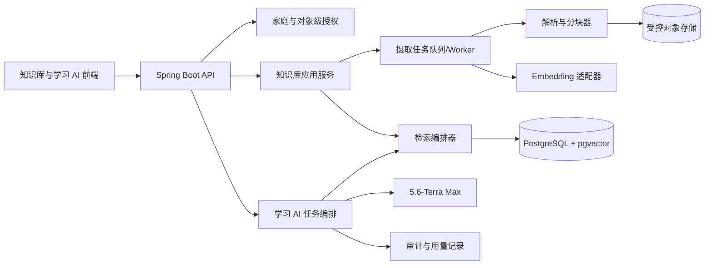
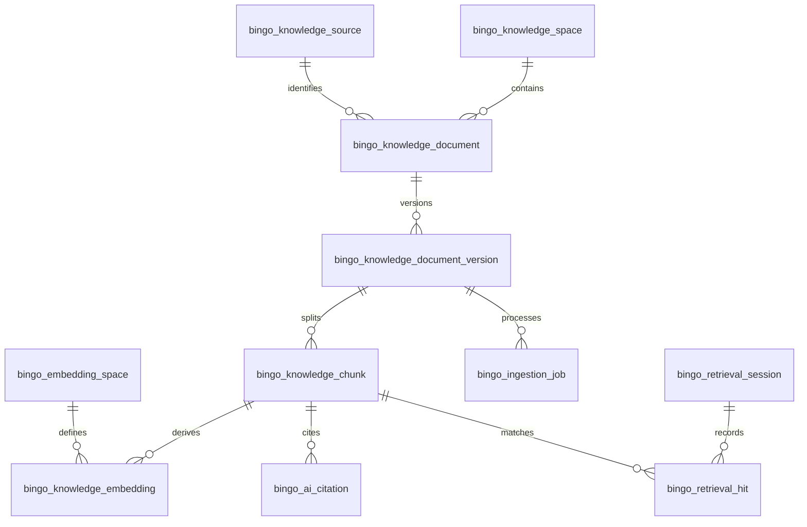
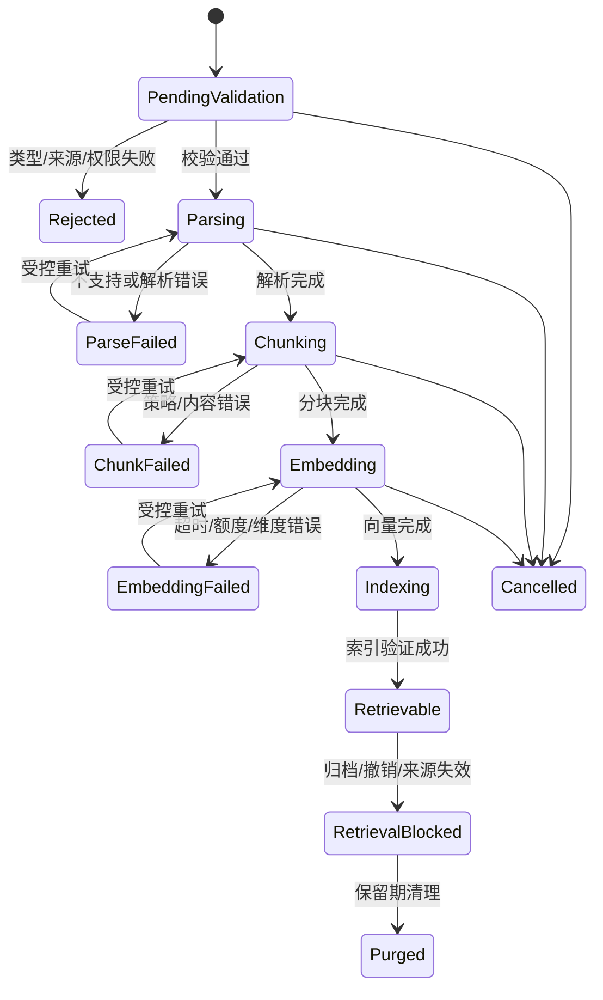

# 知识库与 PostgreSQL/pgvector 架构

## 1. 设计目标

该设计实现 `FR-KB-*`、`FR-AI-*` 和 `FR-LAI-*` 所需的知识库基础能力：

- 家庭与成员范围内的资料、来源、版本和可见性管理；
- 资料的异步解析、结构化分块、Embedding 和向量索引；
- 在 **数据库查询层** 完成授权过滤的 pgvector 语义检索；
- 词法检索、语义检索、重排、上下文预算和版本化引用；
- 可审计的摄取/检索过程，以及 AI 关闭、索引失败和权限撤销时的可恢复降级。

它不实现全局互联网抓取、无授权资料分发、任意 URL 代理、模型训练数据管线或自动发布学习内容。

## 2. 技术决策

| 决策           | 选择                                                             | 理由与约束                                                                                                      |
| -------------- | ---------------------------------------------------------------- | --------------------------------------------------------------------------------------------------------------- |
| 关系与向量存储 | PostgreSQL + pgvector                                            | 资料元数据、权限、事务、全文检索和向量检索保持在同一一致性边界。                                                |
| 向量列         | 每个 Embedding 模型/维度一个固定向量空间                         | pgvector 列维度必须与实际模型输出一致；模型升级不可把不同维度混入同一列。                                       |
| 索引策略       | 初始以 HNSW 作为高频增量召回候选；IVFFlat 作为经过基准验证的替代 | 具体索引、距离度量、构建参数和查询参数必须与目标 pgvector/PostgreSQL 版本、数据量和过滤选择性做基准测试后固定。 |
| 词法检索       | PostgreSQL `tsvector`/全文检索                                   | 支持课程编号、章节名、词汇、短语和精确术语，与语义召回形成混合检索。                                            |
| 任务执行       | 数据库记录的摄取任务 + 受控 worker                               | 解析/Embedding/重索引不阻塞普通请求，状态可重试、可取消、可审计。                                               |
| 文件正文       | 受控 NAS 或 S3 兼容对象存储，数据库只存元数据与安全引用          | 资料文件不通过公开 URL 或数据库日志暴露；派生文本按保留策略管理。                                               |
| 访问控制       | 后端对象级授权为主，SQL 中强制范围谓词；可选 RLS 作为纵深防御    | 不允许先全局 Top-K 再在应用层过滤；数据库连接上下文和 RLS 配置须单独验证。                                      |

## 3. 组件边界



### 3.1 模块职责

| 组件             | 负责                                                             | 不负责                                         |
| ---------------- | ---------------------------------------------------------------- | ---------------------------------------------- |
| 知识库应用服务   | 空间/来源/文档/版本生命周期、授权入口、读取 API                  | 直接调用模型、解析任意网络地址。               |
| 摄取 worker      | 任务状态、文件读取、解析、分块、Embedding、索引状态              | 把资料直接发布到学习任务。                     |
| 检索编排器       | 授权范围、查询归一化、候选召回、混合合并、重排、上下文构建、引用 | 生成用户最终回答。                             |
| Embedding 服务 | 通过 Spring AI `EmbeddingModel` 生成向量，负责批量、维度校验、超时/额度与失败摘要 | 保存密钥或把提供商 SDK 泄漏到业务模块。 |
| 学习 AI 编排器   | 任务 schema、token 预算、结构化输出、草稿与采纳                  | 绕过检索授权或修改知识库源资料。               |
| PostgreSQL       | 元数据、访问范围、版本、分块、向量、全文索引、审计引用           | 存放明文密钥、公开文件或无边界的原始模型载荷。 |

## 4. 数据模型

### 4.1 主表与归属

以下均为物理表名，遵循[数据库表命名强制规范](README.md#数据库表命名规范强制)，统一使用 `bingo_` 前缀。

| 表                           | 关键列                                                                                                                                             | 约束/索引意图                                                                 |
| ---------------------------- | -------------------------------------------------------------------------------------------------------------------------------------------------- | ----------------------------------------------------------------------------- |
| `bingo_knowledge_space`            | `id`, `household_id`, `name`, `purpose`, `visibility_policy`, `status`                                                                             | `(household_id, status)`；每行属于一个家庭。                                  |
| `bingo_knowledge_space_member`     | `space_id`, `member_id`, `capability`, `status`                                                                                                    | 唯一 `(space_id, member_id, capability)`；表达显式成员授权。                  |
| `bingo_knowledge_source`           | `id`, `household_id`, `source_type`, `license_status`, `title`, `source_url`, `reviewed_at`, `status`                                              | 来源状态决定是否能进入新检索。                                                |
| `bingo_knowledge_document`         | `id`, `space_id`, `source_id`, `content_type`, `owner_member_id`, `visibility_policy`, `status`                                                    | 文档不能脱离空间与来源。                                                      |
| `bingo_knowledge_document_version` | `id`, `document_id`, `version_number`, `content_digest`, `media_type`, `parser_version`, `status`                                                  | 唯一 `(document_id, version_number)`；版本不可变。                            |
| `bingo_knowledge_chunk`            | `id`, `version_id`, `ordinal`, `heading_path`, `content`, `content_tsv`, `token_count`, `source_locator`, `visibility_snapshot`, `retrieval_state` | 唯一 `(version_id, ordinal)`；正文和全文索引同属版本。                        |
| `bingo_knowledge_embedding`        | `id`, `chunk_id`, `embedding_space_id`, `content_digest`, `embedding`, `status`, `generated_at`                                                    | 唯一 `(chunk_id, embedding_space_id, content_digest)`；Embedding 是派生数据。 |
| `bingo_embedding_space`            | `id`, `provider`, `model_id`, `dimension`, `distance_metric`, `status`                                                                             | 不同维度或模型版本绝不混合。                                                  |
| `bingo_ingestion_job`              | `id`, `version_id`, `idempotency_key`, `stage`, `status`, `attempt_count`, `error_code`                                                            | 唯一幂等约束阻止同版本并发摄取。                                              |
| `bingo_retrieval_session`          | `id`, `household_id`, `member_id`, `task_type`, `query_digest`, `authorization_revision`, `status`                                                 | 审计检索，不默认保存原问题全文。                                              |
| `bingo_retrieval_hit`              | `session_id`, `chunk_id`, `candidate_rank`, `vector_score`, `lexical_score`, `rerank_score`, `selected`                                            | 解释实际证据选择。                                                            |
| `bingo_ai_citation`                | `draft_id`, `version_id`, `chunk_id`, `display_label`, `source_locator`                                                                            | 输出与知识证据的稳定绑定。                                                    |

所有业务表还应具备 UUID 主键、`created_at`、`created_by`、`updated_at`（适用时）与必要的乐观锁/状态版本列。时间统一存储 UTC，显示使用家庭时区。

### 4.2 版本链与删除语义



状态转换必须可审计：

1. 文档版本先进入 `PENDING_VALIDATION`，通过来源和文件校验后才可解析。
2. 解析、分块、Embedding、索引成功后才转为 `RETRIEVABLE`。
3. 归档、来源失效、权限缩小或删除请求先使版本变为 `RETRIEVAL_BLOCKED`，下一次检索立即排除。
4. 异步物理清理分块、向量和原始媒介后转为 `PURGED`；历史引用保留最小可解释元数据，不恢复正文。

## 5. Flyway 与 pgvector 部署策略

### 5.1 前置条件

- 知识库启用的环境必须使用已安装 pgvector 扩展的 PostgreSQL 镜像或服务器发行版。
- `CREATE EXTENSION vector` 属于部署能力检查，而不是由应用临时下载的依赖。
- 如果某环境不提供 pgvector，知识库功能开关保持关闭，向量特定迁移和 worker 不应被启用；普通身份、学习记录和非 AI 业务可以运行。
- 一旦在某生产数据库启用知识库迁移，该数据库之后必须持续具备 pgvector。缺失扩展应使知识库部署/健康检查失败，不能悄悄回退为不安全的字符串相似度。

### 5.2 建议迁移序列

| 迁移                                | 内容                                                  | 验证                                                  |
| ----------------------------------- | ----------------------------------------------------- | ----------------------------------------------------- |
| `V100__enable_pgvector.sql`         | 在知识库 profile 中启用 `vector` 扩展并验证可用性。   | 启动集成测试执行 `SELECT extname FROM pg_extension`。 |
| `V101__create_knowledge_space.sql`  | 空间、成员授权、来源、文档和版本表。                  | 家庭隔离和唯一约束测试。                              |
| `V102__create_knowledge_chunks.sql` | 分块、全文检索列、摄取任务与状态约束。                | 版本不可变与任务幂等测试。                            |
| `V103__create_embedding_spaces.sql` | 模型/维度空间和 Embedding 表。                        | 尺寸不匹配、重复 Embedding 和失效状态测试。           |
| `V104__create_retrieval_audit.sql`  | 检索会话、命中、引用、评测和审计关联。                | 撤销授权后无新命中测试。                              |
| `V105__add_vector_indexes.sql`      | 经过基准确认的 HNSW/IVFFlat、B-tree、全文和部分索引。 | `EXPLAIN (ANALYZE, BUFFERS)` 基准与召回评测。         |

实际版本号只在工程落地时确定；已应用迁移不可修改。高成本索引构建、重建和大批量回填必须以独立发布步骤/维护窗口设计，避免多实例同时启动时争抢资源。

### 5.3 向量空间与索引设计

1. 每个 `bingo_embedding_space` 固定 `model_id`、`dimension`、距离度量和状态。常用设计是一个兼容模型版本对应一张/一列固定维度的向量表或分区。
2. 推荐先为 `retrieval_state = 'RETRIEVABLE'` 的向量建立部分向量索引，并单独建立过滤所需的关系索引，例如空间、版本、状态和成员授权关系。
3. HNSW 通常适合持续插入后的低延迟近邻查询；IVFFlat 通常需要在已有足够数据后训练/构建。二者不是“默认正确”，必须用实际资料规模和过滤选择性测量召回、P95 延迟、写入开销和维护成本。
4. 当 pgvector 目标版本支持迭代近似扫描时，可在严格 SQL 权限谓词下评估其对过滤查询的召回帮助；目标版本不支持时，使用受限候选集、SQL 内过滤和基准驱动的过取策略，绝不在应用层拿全局结果后过滤权限。
5. 只有在模型维度、PostgreSQL/pgvector 版本和运行环境验证后，才考虑 `halfvec`、量化、分区或更激进的索引压缩。

## 6. 安全检索查询形状

### 6.1 不允许的形状

```text
全局向量 Top-K -> Java 内存过滤 household/member -> 返回结果
```

这个形状可能泄漏无权资料的相似分数、数量或存在性，也会导致过滤后结果不足。

### 6.2 允许的形状

```text
当前请求主体
  -> 后端计算家庭、成员、空间、来源、版本、状态授权范围
  -> 单条参数化 SQL 中 JOIN/EXISTS 限定这些范围
  -> 在该范围内执行向量和全文候选召回
  -> SQL/服务端受控重排、去重和上下文预算
  -> 仅返回经过引用映射的候选
```

概念查询必须至少满足以下性质：

- 参数中包含当前家庭和当前成员/可管理成员集合，不能只接受前端传来的 `spaceId`。
- `bingo_knowledge_space.status`、`bingo_knowledge_source.status`、`bingo_knowledge_document.status`、版本和分块的 `retrieval_state` 都参与谓词。
- 显式成员授权与角色派生授权使用 `EXISTS` 或等价关系约束，而不是先在内存装载全部 ACL。
- 向量空间 ID、维度和模型状态参与查询，防止跨模型比较。
- 查询、日志和错误不返回无权候选的标题、分数、ID 或计数。

可选的 PostgreSQL RLS 可作为第二层防线，但只能在每个事务安全设置不可伪造的家庭/成员上下文且经过连接池重置测试后启用；它不替代应用服务的对象级授权。

## 7. 摄取工作流



### 7.1 Worker 约束

- 使用数据库任务记录/出站事件或经过确认的队列，任务声明锁和幂等键防止多 worker 重复处理。
- 每一步提交可恢复状态。大文件和大批量分块分页处理，禁止将完整文档一次装入应用堆内存。
- 失败只记录错误代码、阶段、可行动摘要和追踪 ID。不要把正文、二进制文件、密钥或提供商原始响应写入日志。
- 重试采用有限次数、指数退避和可见状态；对永久错误停止自动重试，要求用户修正来源/资料/配置。
- 取消、撤销和归档在每个阶段检查状态；已在飞行中的向量结果在事务提交前再次检查版本可检索性。

## 8. 检索与 RAG 上下文构建

### 8.1 请求阶段

1. 验证会话、家庭上下文、目标成员、学习任务和知识库范围。
2. 生成最小化检索计划：查询摘要、语言、内容类型、目标知识点、最大结果数和上下文 token 预算。
3. 生成查询 Embedding，校验模型/维度与 `bingo_embedding_space` 兼容；提供商不可用时返回明确的检索不可用状态。
4. 在数据库中执行 ACL 范围内的语义和词法候选查询。
5. 对候选执行去重、相邻片段扩展、混合合并和可选重排，始终保持来源、版本和权限边界。
6. 按 token 预算选择最终证据，生成稳定引用 ID、显示标签和源定位。
7. 把“系统策略”“用户问题”“学习快照”“不可信资料片段”“引用元数据”作为不同字段交给 AI 编排器。

### 8.2 混合检索

| 阶段       | 技术                                      | 输出                                               |
| ---------- | ----------------------------------------- | -------------------------------------------------- |
| 语义候选   | pgvector 距离查询                         | 概念相近、措辞不同的分块。                         |
| 词法候选   | PostgreSQL 全文检索/精确过滤              | 课程编号、章节、词汇、短语和专有名词。             |
| 合并       | Reciprocal Rank Fusion 或经验证的加权规则 | 去除单一分数尺度偏差的候选集合。                   |
| 重排       | 规则或独立重排模型                        | 综合任务类型、来源状态、标题匹配、新鲜度和相关性。 |
| 上下文打包 | 去重、相邻窗口、token 预算                | 小而相关、可引用、权限安全的证据包。               |

任何重排模型只能读取通过 ACL 过滤的候选。若重排超时或不可用，系统回退到已授权的基础混合排序，并在审计中记录回退。

### 8.3 缓存

- 检索缓存键至少包含家庭、成员或授权快照、空间范围、查询规范化哈希、版本/索引修订号、任务类型和语言。
- 授权、来源、文档、版本、分块或索引状态变化时使相关缓存失效。
- 不能缓存完整跨成员 AI 回答作为通用答案；包含用户问题、儿童资料或私有笔记的缓存按成员和保留策略隔离。

## 9. API 轮廓

知识库空间、来源、上传、文档、摄取任务和检索端点统一维护在 [API 契约](04-knowledge-ai-api-contract.md)，不在本文件重复列举。所有 ID 路径重新验证家庭和对象级授权；详情和错误不得泄漏无权对象的存在性。

## 10. 运维与质量验证

### 10.1 健康与指标

| 指标                        | 说明                             | 敏感性                      |
| --------------------------- | -------------------------------- | --------------------------- |
| 摄取队列深度/等待时间       | 识别 worker 饱和与卡住任务       | 仅聚合。                    |
| 解析/Embedding/索引失败率   | 按阶段、错误类别和模型版本观察   | 不含正文。                  |
| 检索 P50/P95                | 区分数据库召回、重排、上下文构建 | 不含查询文本。              |
| 无结果率与引用覆盖率        | 识别资料缺口与生成质量风险       | 仅聚合到家庭/系统安全级别。 |
| pgvector 索引大小与构建时间 | 容量、维护与发布规划             | 不含文档内容。              |
| 向量空间版本分布            | 跟踪重索引迁移进度               | 不含成员身份。              |

### 10.2 基准与回归

1. 建立无真实家庭/儿童/健康信息的许可测试集，包含中文课程、英文词汇、表格、错题、无结果和故意提示注入样本。
2. 记录每个查询的期望资料、禁止命中资料、最低引用覆盖、最大检索延迟和可接受的上下文 token。
3. 对 HNSW/IVFFlat、索引参数、过滤选择性、混合检索权重、Embedding 模型与重排策略运行召回、延迟、写入和成本基准。
4. 在模型、维度、分块、索引、权限 SQL 或来源策略变更前后比较评测结果；回归必须阻止默认策略自动切换。
5. 在集成测试中验证跨家庭隔离、成员撤销后即时排除、来源失效、版本归档、任务幂等、维度错误和 provider 不可用降级。

## 11. 未决部署决策

- 正式 PostgreSQL 版本、pgvector 版本、安装方式和启用 profile。
- 5.6-Terra Max 的正式 `modelId`，以及 Embedding 提供商/模型、维度、区域、费用和数据驻留承诺。
- 对目标资料量、并发、过滤选择性和硬件执行后的 HNSW/IVFFlat 选择及参数。
- 用户可上传的文件类型、大小、OCR/转写范围、对象存储、病毒扫描和保留期。
- 是否启用 PostgreSQL RLS，以及连接池事务上下文的可靠实现和测试策略。

## 12. 关联需求

- [知识库与检索增强生成需求](../requirements/09-knowledge-base-rag.md)
- [学习 AI 体验与技术需求](../requirements/10-learning-ai-experience.md)
- [AI 草稿与治理需求](../requirements/06-ai-drafts-governance.md)
- [非功能与质量要求](../requirements/08-non-functional-quality.md)
