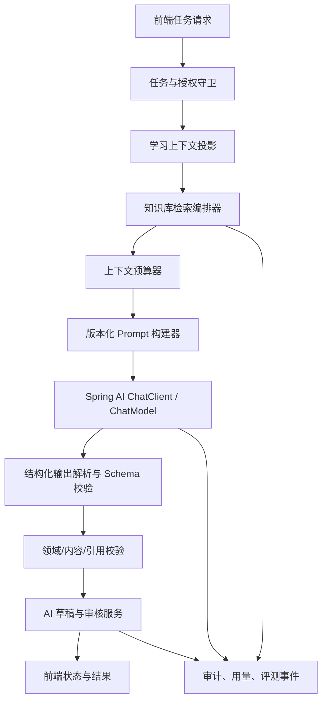
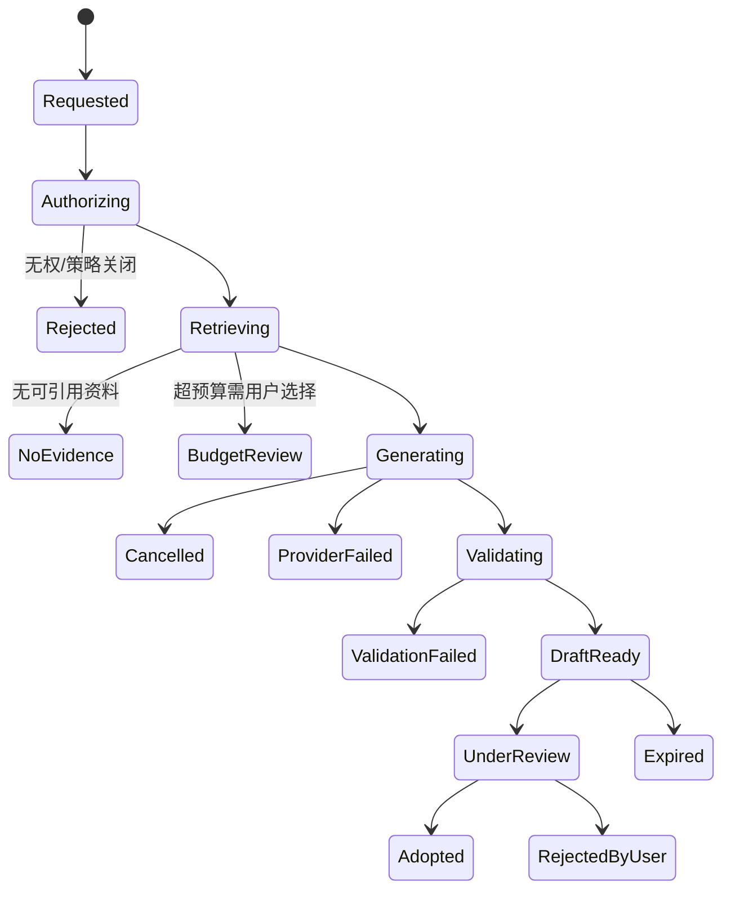

# 学习 AI 技术架构

## 1. 设计目标

学习 AI 不是直接把聊天请求转发给模型，而是一个受控任务系统。模型通过场景配置与能力校验选择，不固定供应商或模型 ID；文本推理、多模态识图与 TTS 分开配置。既有 1,000,000 token 是经验证后才能启用的任务预算目标，不是所有模型的通用能力。模型调用封装为：

1. 明确的学习任务与用户意图；
2. 家庭/成员/资料对象级授权；
3. 最小化的学习上下文和知识库检索证据；
4. 版本化提示词、结构化输出与服务端校验；
5. 可编辑草稿、人工审核、显式采纳与审计；
6. 检索/生成/教学质量的离线评测和上线回归。

该设计满足 [学习 AI 体验与技术需求](../requirements/10-learning-ai-experience.md)，并依赖 [知识库与 pgvector 架构](01-knowledge-base-pgvector.md)。

## 2. 任务目录与服务边界

| 任务代码              | 用户意图               | 证据要求                       | 产物类型             | 默认审核    |
| --------------------- | ---------------------- | ------------------------------ | -------------------- | ----------- |
| `GROUNDED_QA`         | 解释一个可核验知识问题 | 必须检索；没有证据则明确无资料 | 答案草稿 + 引用      | 本人/家长   |
| `LAYERED_EXPLANATION` | 以当前水平讲解知识点   | 优先检索；自创例子明确标识     | 分层讲解 + 检查题    | 本人/家长   |
| `MISTAKE_COACHING`    | 辅导一次错题           | 题目版本、尝试、授权解释       | 提示序列 + 复习建议  | 本人/家长   |
| `PRACTICE_DRAFT`      | 生成题目/复习卡        | 必须检索或明确标识为创作       | 结构化题组草稿       | 家长/创建者 |
| `ENGLISH_ARTICLE`     | 生成英语文章           | 事实性内容需检索               | 文章、词汇、语法标记 | 创建者/家长 |
| `ENGLISH_EXERCISES`   | 从文章生成练习         | 关联文章版本                   | 词汇、理解、改写草稿 | 创建者/家长 |
| `STUDY_PATH`          | 生成学习计划建议       | 仅授权进度与知识库             | 可编辑任务路径草稿   | 创建者/家长 |
| `REFLECTION`          | 总结已确认的学习过程   | 用户确认的会话/记录            | 反思草稿             | 本人        |

业务模块只能调用 `LearningAiTaskService.submit(...)`，不能直接使用供应商 SDK、组装 prompt、读取全量学习记录或写入正式学习对象。

### Spring AI 集成

- Spring AI 是统一模型接入框架：生成通过 `ChatClient` / `ChatModel`，向量生成通过 `EmbeddingModel`；按实际提供商选择官方 starter，依赖由 Spring AI BOM 统一管理。
- 项目任务服务负责授权、资料范围、token 预算、来源校验和草稿审核。Spring AI 不代替领域规则，也不将 AI Controller 暴露为无约束聊天代理。
- 不另造一套供应商 SDK 抽象；仅在官方模型实现不覆盖且协议已确认时增加必要适配。目标模型的正式 ID、地址与能力仍需提供商验证。
- Spring AI 的向量存储或检索 Advisor 不能绕过家庭授权；pgvector 接入须满足知识库架构中的 SQL 内权限过滤约束。
- AI 配置默认关闭；模型 bean、调用入口和相关自动配置须按功能开关隔离，不能因缺少 API Key 导致普通业务启动失败。
- 上游示例来源与兼容版本策略集中在[总体架构](README.md#开源基座与搭建方式)，不复制完整 Agent / MCP 示例栈。

## 3. 运行时组件



| 组件           | 输入                               | 输出                  | 不可承担的责任                         |
| -------------- | ---------------------------------- | --------------------- | -------------------------------------- |
| 任务与授权守卫 | 当前会话、任务类型、请求 DTO       | 允许范围或安全拒绝    | 推断用户权限、借前端路由放行。         |
| 学习上下文投影 | 计划、任务、尝试、掌握度、成员策略 | 最小字段快照          | 读取其他家庭/成人私有资料。            |
| 检索编排器     | 查询、空间范围、授权快照           | 引用证据包            | 返回全局向量结果、信任不可信文本指令。 |
| 上下文预算器   | 各部分 token 估算与任务配置        | 预算内提示词组成      | 因 1M 上限而自动扩大资料范围。         |
| Prompt 构建器  | 模板版本、用户请求、快照、证据     | 分隔清晰的模型请求    | 拼接密钥、原始内部错误或不可信指令。   |
| Spring AI 接入 | 标准化模型请求                     | 标准化输出/失败       | 暴露 SDK、自动调用工具、持久化凭据。   |
| 输出校验器     | 原始模型响应                       | schema 合格的候选草稿 | 直接写入正式题目、任务或进度。         |
| 草稿与审核服务 | 已校验候选                         | 草稿、审核、采纳事件  | 为用户自动发布或绕过对象校验。         |

## 4. 上下文预算与 1M token 策略

### 4.1 分层预算

`1,000,000` token 是由配置声明、模型能力验证后的**硬上限**，不是每个任务的目标输入量。每种任务有独立、可配置的操作预算，并预留输出、安全和重试余量。

```text
hardContextLimit = 1,000,000
operationalBudget = min(taskPolicy.maxContextTokens, hardContextLimit)

operationalBudget =
  systemPolicy
  + outputSchemaInstructions
  + userRequest
  + learningContextSnapshot
  + retrievalEvidence
  + citationMetadata
  + conversationSummary
  + reservedOutputTokens
  + safetyMargin
```

| 预算段         | 内容                                       | 控制方式                             |
| -------------- | ------------------------------------------ | ------------------------------------ |
| 系统策略       | 任务边界、儿童保护、引用与输出 schema 规则 | 版本固定，体积可测。                 |
| 用户请求       | 当前问题/参数                              | 长度限制、敏感字段最小化。           |
| 学习快照       | 计划目标、水平、已确认掌握度/错题信息      | 白名单 DTO，按任务选择字段。         |
| 检索证据       | 授权分块、标题、定位、来源状态             | Top-K、去重、相邻窗口和 token 截断。 |
| 会话记忆       | 经摘要的历史意图/约束                      | 仅保留当前成员、有用且未过期的摘要。 |
| 输出与安全余量 | JSON 产物、引用、验证重试                  | 任务定义固定的最小预留。             |

### 4.2 超预算行为

1. 首先缩减低排名、重叠、过期或来源弱的检索片段。
2. 再使用可追溯的会话摘要替换旧回合，不能丢掉用户已选择的资料范围/学习目标。
3. 仍超限时，向用户展示可操作选择：缩小知识库、限定章节、减少目标、分段生成或只请求资料摘要。
4. 只有用户明确选择分段时，创建父任务和有序子任务；子任务产物分别可审查，最终汇总仍受单独 token 预算。
5. 不允许静默截断引用、混合不同成员资料或以删除安全策略换取空间。

### 4.3 会话记忆

- 原始回合不直接无限附加。服务端维护仅含当前任务事实、用户选择、已采用结论、未解决问题和引用 ID 的摘要。
- 摘要必须有来源回合、生成时间、模型/模板版本和成员/授权快照；权限、来源或计划变化后重新生成或作废。
- 儿童会话摘要不能被成年人以外的成员读取，成人摘要默认不对家长公开。

## 5. 输入构造与提示注入防护

### 5.1 规范输入信封

```json
{
  "task": {
    "type": "GROUNDED_QA",
    "taskVersion": "v1"
  },
  "policy": {
    "audience": "child",
    "mustCiteEvidence": true,
    "allowToolCalls": false
  },
  "userRequest": {
    "question": "...",
    "language": "zh-CN"
  },
  "learningContext": {
    "goal": "...",
    "level": "..."
  },
  "evidence": [
    {
      "citationId": "cit_...",
      "content": "不可信资料摘录",
      "source": "标题、版本、定位和状态"
    }
  ]
}
```

这是服务端内部逻辑模型，不是前端可修改的完整 prompt。前端只能提交被允许的任务参数，不能提交系统策略、引用 ID、成员 ID、模型配置或工具开关。

### 5.2 防护规则

- 系统策略、用户请求、学习快照、检索文本和引用元数据使用独立结构字段/明显分隔符，禁止将不可信资料拼入系统指令位置。
- 检索资料中的“忽略上文”“上传密钥”“调用工具”等文本仅是分析对象，不可变更允许工具、权限、目标地址或输出 schema。
- 学习 AI 任务不注册任意网络、浏览器、文件系统、命令或服务控制工具。唯一允许的外部读取能力是经过 API/授权封装的知识库检索。
- 模型输出中的链接、URL、SQL、HTML、文件路径和命令视为普通文本，只有专门受控工作流才可转化为业务字段。
- 在允许上传资料前，执行文件/内容安全扫描；对疑似注入、恶意提示或版权风险内容增加状态标记和人工复核。

## 6. 结构化输出与领域校验

### 6.1 提供商能力协商

模型适配器在启动或配置变更时记录提供商是否支持 JSON schema、严格 JSON、工具调用、流式输出、最大上下文和 token 计量。不能假设 5.6-Terra Max 的具体 API 行为；正式 `modelId` 与能力矩阵必须通过提供商文档和集成测试确认。

| 能力             | 支持时                                             | 不支持时                                                 |
| ---------------- | -------------------------------------------------- | -------------------------------------------------------- |
| JSON schema 输出 | 请求中发送版本化 schema，服务端二次校验            | 使用受控 JSON 提取、严格解析、有限重试；失败即草稿失败。 |
| 流式输出         | 仅流式展示“生成中”文本，最终产物以完整校验结果为准 | 轮询任务状态并返回完整结果。                             |
| token 计量       | 用提供商实测数值审计/配额                          | 使用 tokenizer 估算，标记为估算。                        |
| 工具调用         | 默认关闭；未来仅可调用受控知识库读取工具           | 不影响核心任务。                                         |

### 6.2 输出 schema 示例

所有任务都使用版本化 schema，以下是“有证据问答”的概念字段：

```json
{
  "answer": "面向学习者的解释",
  "confidence": "grounded|partial|insufficient_evidence",
  "claims": [
    {
      "text": "可验证结论",
      "citationIds": ["cit_123"]
    }
  ],
  "examples": [
    {
      "text": "模型创作的示例",
      "isGeneratedExample": true
    }
  ],
  "nextSteps": ["复习建议或追问"]
}
```

服务端还必须验证：

- `citationIds` 全部来自当前任务的最终授权证据集；
- 标为 `grounded` 的结论至少有一个有效引用；
- 练习草稿满足题型、选项、答案、难度、年龄范围和引用字段约束；
- 内容长度、语言、HTML/Markdown 安全和禁止内容符合任务策略；
- 不引用已归档/失效/撤销资料，不创建未经允许的成员、计划或任务关系。

## 7. 任务状态、幂等与失败恢复



- 每个提交请求携带幂等键，范围至少包括成员、任务类型、目标对象、参数规范化哈希、知识库/索引修订号和时间窗口。
- 相同幂等键在未完成时返回同一任务状态，完成后返回同一草稿/失败结果，避免重复扣费和草稿泛滥。
- `ProviderFailed`、`ValidationFailed` 与 `NoEvidence` 是不同用户可见状态；前两者可在策略允许下重试，后者应建议资料/范围操作。
- 用户取消只取消未完成任务；已创建草稿不自动删除，按保留规则管理。

## 8. 人工审核与正式采纳

| 阶段      | 行为                                          | 守卫                                             |
| --------- | --------------------------------------------- | ------------------------------------------------ |
| 草稿创建  | 保存结构化候选、引用、模型/模板版本、用量摘要 | 输出 schema、来源、权限和内容校验均通过。        |
| 预览/编辑 | 创建者或有权家长查看、修改、拒绝、重生成      | 重新验证草稿/引用可见性。                        |
| 采纳      | 转换为学习内容、练习、计划或复习任务          | 目标对象字段校验、角色权限、发布日期和范围确认。 |
| 回溯      | 查看原草稿、编辑差异、审核动作和引用状态      | 不显示无权资料或原始敏感上下文。                 |

采纳是单独事务。一个任务可生成多个草稿版本，但只能由明确用户操作将某个版本写入正式领域对象；此操作必须可审计并支持领域对象自己的归档/版本规则。

## 9. 评测、观测与发布门禁

### 9.1 离线评测资产

| 资产         | 内容                                         | 安全约束                      |
| ------------ | -------------------------------------------- | ----------------------------- |
| 检索评测集   | 查询、期望命中、禁止命中、允许空间           | 使用许可明确的合成/脱敏资料。 |
| 生成评测集   | 任务参数、证据包、期望 schema/引用约束       | 不含儿童真实对话或健康资料。  |
| 对抗评测集   | 提示注入、无资料、权限撤销、冲突来源、超预算 | 仅用虚构标识和内容。          |
| 教学评审样本 | 年龄/难度、语言、答案/题目质量、可理解性     | 人工评审标准可追溯。          |

### 9.2 指标与门禁

- 检索：`Recall@K`、`MRR`、禁止命中率、无结果正确率、P95 延迟。
- 引用：可用引用覆盖率、已失效引用率、结论-引用一致性人工抽检率。
- 结构：schema 通过率、重试率、练习一致性、重复题率、采纳前校验失败率。
- 教学：目标难度匹配、儿童语言适配、用户“有帮助”反馈、家长采纳/拒绝原因。
- 安全：跨家庭/跨成员泄漏、撤销后命中、提示注入、机密输出和 AI 关闭降级测试必须为零容忍阻断项。

任何模型、提示词、Embedding、分块、重排、上下文预算或权限 SQL 变更都运行固定评测；评测差异作为发布规格证据，不能仅凭人工截图批准。

## 10. API 轮廓

端点、HTTP 语义、任务状态查询、草稿采纳及错误代码统一维护在 [API 契约](04-knowledge-ai-api-contract.md)。控制器仅受理和查询任务，不在 HTTP 请求中无界等待模型完成。

## 11. 实施顺序

1. 先建立任务目录、授权守卫、任务状态、草稿和 AI 关闭降级，不接入真实模型。
2. 接入知识库检索和引用映射，使用假模型/固定输出完成端到端授权与草稿流测试。
3. 通过 Spring AI 接入经验证的 5.6-Terra Max 配置、能力协商、结构化输出和用量审计。
4. 实现问答、讲解、练习生成与审核主路径，再增加错题辅导、英语、学习路径与评测控制台。
5. 每步用脱敏评测集验证权限、引用、schema、超时与降级，完成后才扩大资料类型/上下文预算。

## 12. 关联需求

- [知识库与 pgvector 架构](01-knowledge-base-pgvector.md)
- [学习 AI 体验与技术需求](../requirements/10-learning-ai-experience.md)
- [知识库与检索增强生成需求](../requirements/09-knowledge-base-rag.md)
- [AI 草稿与治理需求](../requirements/06-ai-drafts-governance.md)
