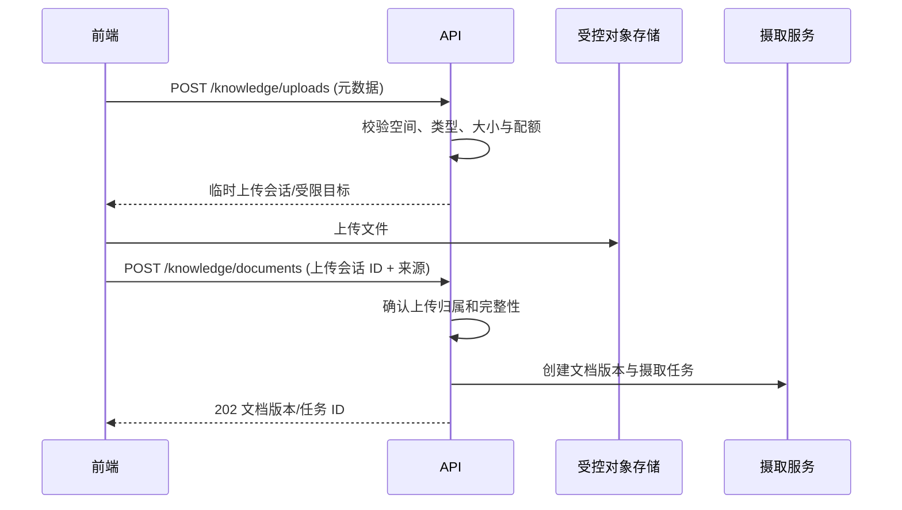

# 知识库与学习 AI API 契约设计

## 1. 范围

本文件将知识库、摄取、检索、学习 AI 任务、草稿审核和评测接口细化为 OpenAPI 设计前的契约轮廓。它不是已发布 API；实际端点、DTO 和字段需写入 `api-contract/openapi.yaml` 后才成为可生成的客户端契约。

目标是让 PC Web、未来微信小程序和后端使用相同业务规则，特别是家庭上下文、对象级授权、异步任务、幂等、来源证据和 AI 草稿状态。

## 2. 统一约定

| 主题       | 契约                                                                                                                               |
| ---------- | ---------------------------------------------------------------------------------------------------------------------------------- |
| 基础路径   | `/api/v1`，使用 Spring MVC RESTful / JSON；下文端点均省略此公共前缀。 |
| 身份与家庭 | 会话身份由服务端解析；当前家庭/成员上下文从已授权会话与显式安全切换确定，客户端提供的 ID 只作请求目标，不能决定权限。              |
| 标识       | 外部 ID 使用 UUID/不可猜测标识；不暴露数据库递增主键或对象存在性。                                                                 |
| 时间       | ISO-8601 UTC 时间戳；日期范围接口以明确时区/日期语义说明。                                                                         |
| 分页       | `page`、`size`、`sort` 与稳定游标/页码策略统一；响应包含安全范围内的总数或 `hasNext`。                                             |
| 幂等       | 所有创建摄取任务、学习 AI 任务、重试、采纳和批量写入接口接受 `Idempotency-Key`。                                                   |
| 并发       | 可编辑资源返回 `version`/ETag；更新请求携带版本，冲突返回明确业务错误。                                                            |
| 追踪       | 请求可携带/接收 `X-Request-Id`；响应、日志与审计使用该 ID，但不把用户内容编码进 ID。                                               |
| 错误       | 使用 Spring `ProblemDetail` / `application/problem+json`：标准 `type`、`title`、`status`、`detail`、`instance`，扩展 `code`、`fieldErrors`（可选）、`requestId`；不返回堆栈、SQL、密钥或无权对象信息。 |

### Spring MVC 实现约定

- 使用 `@RestController`、`@RequestMapping` 和对应 HTTP 方法映射；Controller 负责绑定、参数校验和 HTTP 响应，Service 负责业务、授权及事务，Repository 负责持久化，均采用构造器注入。
- 请求/响应使用独立 DTO；通过 Bean Validation 校验输入，通过 `@RestControllerAdvice` 统一转换异常，不将数据库实体、模型原始响应或内部异常直接返回客户端。
- 路径使用复数资源名；`GET` 只读，`POST` 创建资源，`PUT` 完整替换，`PATCH` 部分更新，`DELETE` 删除。取消、重试、审核和采纳建模为子资源，不使用 `/getList`、`/save` 或 `:cancel` 等动作式路由。
- 同步创建返回 `201` 并提供 `Location`；异步受理返回 `202` 并提供任务查询地址；无响应体的成功删除返回 `204`。失败使用相应 `4xx/5xx`，不能统一返回 HTTP `200` 再在业务码中表达失败。
- Spring Security 负责认证及入口规则；Service 在每个资源操作中执行家庭/成员对象级授权。数据库写操作、草稿正式采纳与审计保持必要的事务一致性。
- MVC 是对外 API 基线；不因 Spring AI 的内部流式客户端依赖就改成全站 WebFlux。AI 长任务由受控 worker 执行，HTTP 请求仅提交或查询任务。

## 3. 资源与权限矩阵

| 资源         | 读取                     | 创建/修改               | 高风险操作                      |
| ------------ | ------------------------ | ----------------------- | ------------------------------- |
| 知识库空间   | 显式成员、角色派生成员   | 家长/成人在有权家庭范围 | 归档、成员范围变更、删除请求。  |
| 来源与文档   | 空间/文档读取权          | 空间摄取或管理权        | 使来源失效、归档、版本清理。    |
| 摄取任务     | 创建者、空间管理者       | 由摄取服务创建          | 重试、取消、清理。              |
| 检索会话     | 发起成员、有权审核者     | 发起成员创建            | 查看技术解释/反馈在角色范围内。 |
| 学习 AI 任务 | 发起成员、有权家长审核者 | 当前成员在允许任务范围  | 取消、重试、采纳草稿。          |
| 草稿与引用   | 创建者、有权审核者       | 服务生成/用户编辑       | 采纳、拒绝、过期。              |
| 评测         | 受限系统/部署管理员      | 受限系统/部署管理员     | 变更默认模型/策略需独立审批。   |

每个路径参数、查询参数、嵌套资源和导出操作都重新进行对象级授权；通过 `404`/`403` 的统一安全策略避免无权主体识别资源存在。

## 4. 知识库空间与来源 API

### 4.1 空间

| 方法与路径                                           | 请求重点                  | 响应重点                          | 语义                               |
| ---------------------------------------------------- | ------------------------- | --------------------------------- | ---------------------------------- |
| `GET /knowledge/spaces`                              | `status`、`purpose`、分页 | 安全空间摘要、能力、资料/任务计数 | 只列当前成员可见空间。             |
| `POST /knowledge/spaces`                             | 名称、用途、默认可见范围  | 新空间及其安全能力                | 创建者不能设置超过自身权限的范围。 |
| `GET /knowledge/spaces/{spaceId}`                    | 无                        | 详情、来源/文档安全摘要、能力     | 检查空间读取权。                   |
| `PATCH /knowledge/spaces/{spaceId}`                  | `version`、可编辑字段     | 更新后详情                        | 权限缩小触发缓存失效/检索阻断。    |
| `POST /knowledge/spaces/{spaceId}/archives`          | `version`、原因摘要       | 归档记录与空间状态                | 停止新摄取/新检索，保留历史解释。  |
| `GET /knowledge/spaces/{spaceId}/members`            | 分页                      | 显式成员、能力、状态              | 家长/空间管理者限定可见。          |
| `PUT /knowledge/spaces/{spaceId}/members/{memberId}` | 能力、状态、版本          | 当前授权                          | 不能扩大到操作者无权成员。         |

### 4.2 来源

| 方法与路径                                  | 请求重点                               | 响应重点               | 语义                                |
| ------------------------------------------- | -------------------------------------- | ---------------------- | ----------------------------------- |
| `GET /knowledge/sources`                    | 空间、状态、类型、分页                 | 脱敏来源摘要与可见状态 | 只返回可读来源。                    |
| `POST /knowledge/sources`                   | 类型、标题、许可/授权声明、URL（可选） | 来源与复核状态         | URL 只是元数据，不能触发任意抓取。  |
| `PATCH /knowledge/sources/{sourceId}`       | 版本、状态、复核信息                   | 新状态与影响摘要       | 失效/不允许检索使相关版本立即阻断。 |
| `POST /knowledge/sources/{sourceId}/reviews` | 许可结论、说明摘要                   | 复核事件               | 仅有权管理者操作。                  |

## 5. 上传、文档与版本 API

### 5.1 受控上传流程



上传目标必须短时有效、绑定家庭/空间/上传会话、限制大小/类型，不返回长期公开 URL。客户端不能自行将任意存储对象绑定到文档。

### 5.2 端点

| 方法与路径                                             | 请求重点                                   | 响应重点                        | 幂等/状态                  |
| ------------------------------------------------------ | ------------------------------------------ | ------------------------------- | -------------------------- |
| `POST /knowledge/uploads`                              | 空间、文件名、MIME、大小、摘要             | 上传会话 ID、受限目标、到期时间 | 幂等；未完成上传自动过期。 |
| `POST /knowledge/documents`                            | 空间、来源、类型、可见范围、上传会话或文本 | 文档、初始版本、摄取任务 ID     | `202 Accepted`；创建任务。 |
| `GET /knowledge/documents`                             | 空间/状态/来源/时间筛选、分页              | 文档安全摘要                    | 服务端 ACL 过滤。          |
| `GET /knowledge/documents/{documentId}`                | 无                                         | 文档、可见版本、安全能力        | 权限重验。                 |
| `POST /knowledge/documents/{documentId}/versions`      | 新上传会话/文本、来源更新、版本说明        | 新版本/任务 ID                  | 创建不可变版本。           |
| `POST /knowledge/documents/{documentId}/archives`      | 版本、原因                                 | 归档记录与文档状态              | 立即阻断后续检索。         |
| `GET /knowledge/document-versions/{versionId}/preview` | 可选定位                                   | 受控预览片段/下载许可           | 不返回无权正文。           |

## 6. 摄取任务 API

| 方法与路径                                            | 说明                                                 | 响应                            |
| ----------------------------------------------------- | ---------------------------------------------------- | ------------------------------- |
| `GET /knowledge/ingestion-jobs`                       | 按空间、状态、阶段、时间列出有权任务。               | 安全任务摘要与分页。            |
| `GET /knowledge/ingestion-jobs/{jobId}`               | 获取阶段、进度、最后更新时间、错误代码和可行动摘要。 | 不含原始文件/模型响应。         |
| `POST /knowledge/ingestion-jobs/{jobId}/retries`      | 对允许重试的失败阶段创建或恢复受控任务。             | `202` 新/复用任务状态。         |
| `POST /knowledge/ingestion-jobs/{jobId}/cancellations` | 请求取消可取消任务。                                | `202`；最终结果由状态查询获得。 |
| `GET /knowledge/document-versions/{versionId}/chunks` | 受控查看分块/定位/索引状态。                         | 仅管理者可见技术字段。          |

任务响应使用稳定状态枚举，不用百分比伪装复杂后台实际进度。建议响应字段：

```json
{
  "id": "job_...",
  "status": "EMBEDDING",
  "stage": "EMBEDDING",
  "attempt": 2,
  "updatedAt": "2026-10-15T12:00:00Z",
  "retryAllowed": true,
  "cancelAllowed": true,
  "error": null
}
```

## 7. 检索 API

### 7.1 检索会话创建

`POST /knowledge/retrievals` 建立受控检索会话。请求不能传入任意 `chunkId`、SQL、排序分数、模型 ID 或无权空间。

```json
{
  "taskType": "LEARNING_QA",
  "query": "解释这个概念",
  "spaceIds": ["space_..."],
  "contentTypes": ["KNOWLEDGE_POINT", "NOTE"],
  "language": "zh-CN",
  "maxEvidenceItems": 8
}
```

服务端流程：验证成员/空间权限 -> 规范化查询 -> 计算/请求 Embedding -> SQL 内 ACL 过滤候选 -> 混合检索/重排 -> 保存命中和引用 -> 返回安全结果或异步状态。

### 7.2 检索端点

| 方法与路径                                            | 说明                                               | 响应                                  |
| ----------------------------------------------------- | -------------------------------------------------- | ------------------------------------- |
| `POST /knowledge/retrievals`                          | 创建检索会话；可在配置阈值内同步返回，也可 `202`。 | 会话 ID、状态、可见命中/下一步。      |
| `GET /knowledge/retrievals/{retrievalId}`             | 获取当前成员有权的命中、引用、无结果/冲突状态。    | 引用 ID、标题、定位、状态、安全摘要。 |
| `POST /knowledge/retrievals/{retrievalId}/feedback`   | 标记有帮助/不相关/来源问题/权限问题。              | 反馈记录摘要。                        |
| `GET /knowledge/retrievals/{retrievalId}/explanation` | 管理者查看排名与策略安全摘要。                     | 分数区间、规则、版本，不含无权候选。  |

无可引用证据不是 HTTP 错误，应是 `200/201` 中的 `NO_CITABLE_EVIDENCE` 业务状态。无权、关闭和格式非法使用一致安全错误响应。

## 8. 学习 AI 任务与会话 API

### 8.1 创建任务

`POST /learning-ai/tasks` 是所有生成能力的唯一入口。它接收任务模式与白名单参数，创建异步任务：

```json
{
  "taskType": "PRACTICE_DRAFT",
  "targetMemberId": "member_...",
  "learningPlanId": "plan_...",
  "knowledgeSpaceIds": ["space_..."],
  "parameters": {
    "topic": "...",
    "difficulty": "INTERMEDIATE",
    "questionCount": 5,
    "questionType": "SINGLE_CHOICE",
    "language": "zh-CN"
  }
}
```

服务端忽略/拒绝不允许字段，例如 `systemPrompt`、`providerKey`、`modelId`、`rawContext`、`memberIds`（批量）和 `toolCalls`。

### 8.2 端点

| 方法与路径                                     | 说明                                         | 响应                                               |
| ---------------------------------------------- | -------------------------------------------- | -------------------------------------------------- |
| `POST /learning-ai/tasks`                      | 创建问答、讲解、辅导、练习、英语或路径任务。 | `202` 任务 ID、状态、轮询链接。                    |
| `GET /learning-ai/tasks/{taskId}`              | 查询任务状态和当前成员可见结果。             | 检索/生成/校验状态、草稿 ID、无资料/错误安全摘要。 |
| `POST /learning-ai/tasks/{taskId}/cancellations` | 取消尚未完成的任务。                       | `202`；最终状态通过任务查询获得。                  |
| `POST /learning-ai/tasks/{taskId}/retries`     | 根据策略重新执行失败任务。                   | `202` 新/复用任务 ID 与原因。                      |
| `POST /learning-ai/sessions`                   | 创建可恢复学习会话。                         | 会话及首个任务入口。                               |
| `POST /learning-ai/sessions/{sessionId}/turns` | 新回合；重新授权、检索和预算。               | `202` 新任务/回合。                                |
| `GET /learning-ai/sessions/{sessionId}`        | 加载有权回合、草稿和安全摘要。               | 不含无权资料/完整内部上下文。                      |
| `POST /learning-ai/drafts/{draftId}/adoptions` | 采纳为指定领域对象。                         | 采纳记录、正式对象 ID、审核事件、引用关系。         |
| `POST /learning-ai/drafts/{draftId}/rejections` | 拒绝草稿并可记录简短原因。                  | 拒绝记录与更新后草稿状态。                         |
| `PATCH /learning-ai/drafts/{draftId}`          | 编辑用户可编辑字段。                         | 新草稿修订与校验结果。                             |
| `POST /learning-ai/drafts/{draftId}/feedback`  | 提交草稿质量反馈。                           | 反馈记录与审计摘要。                               |

## 9. 草稿采纳契约

采纳接口必须使用差异化请求，不允许由前端发送任意目标实体 JSON：

| 草稿类型            | 采纳请求允许字段                                    | 服务端额外校验                                 |
| ------------------- | --------------------------------------------------- | ---------------------------------------------- |
| `PRACTICE_SET`      | 目标计划/任务、发布日期、可见范围、用户编辑后的题目 | 单选结构、唯一答案、来源、儿童范围、计划权限。 |
| `EXPLANATION`       | 内容标题、关联知识点、可见范围                      | 内容/来源状态、儿童内容权限。                  |
| `ENGLISH_ARTICLE`   | 目标计划、标题、用户编辑文本、是否包含练习          | 词汇/语法结构、引用、来源与语言。              |
| `STUDY_PATH`        | 选择性任务条目、日期/时长、计划                     | 任务日期、成员权限、重复/冲突。                |
| `REVIEW_SUGGESTION` | 是否创建复习任务                                    | 错题/成员/计划范围。                           |

采纳必须创建领域对象、草稿审计、引用映射和可回溯来源，不能以更新草稿状态作为唯一持久化动作。

## 10. 错误代码目录

| 代码                      | HTTP             | 用户可见含义                                | 不泄漏内容                 |
| ------------------------- | ---------------- | ------------------------------------------- | -------------------------- |
| `AUTHENTICATION_REQUIRED` | 401              | 请重新登录。                                | 账号存在性/会话细节。      |
| `RESOURCE_NOT_AVAILABLE`  | 404/403 策略统一 | 该内容不可用或没有访问权限。                | 对象标题、成员、家庭、ID。 |
| `KNOWLEDGE_SCOPE_EMPTY`   | 422              | 未选择可用资料范围。                        | 无权空间数量。             |
| `NO_CITABLE_EVIDENCE`     | 200/201 业务状态 | 未找到可引用资料，可缩小问题或补充资料。    | 被排除资料。               |
| `SOURCE_NOT_RETRIEVABLE`  | 409              | 来源或版本已失效/归档，不能用于新任务。     | 其他版本/来源。            |
| `INGESTION_NOT_RETRYABLE` | 409              | 当前任务不能重试，请修正资料或创建新版本。  | 解析器内部细节。           |
| `AI_DISABLED`             | 503/409 策略决定 | AI 当前不可用，资料和普通学习功能仍可使用。 | 部署密钥/模型配置。        |
| `CONTEXT_BUDGET_EXCEEDED` | 422              | 请缩小范围或选择分段处理。                  | 内部 prompt。              |
| `OUTPUT_SCHEMA_INVALID`   | 502/422 策略决定 | 生成结果未通过校验，可重试。                | 原始模型输出。             |
| `DRAFT_EXPIRED`           | 409              | 草稿已过期，需要重新生成或审核。            | 已撤销资料正文。           |
| `IDEMPOTENCY_CONFLICT`    | 409              | 相同请求键与不同参数冲突。                  | 其他用户任务。             |

## 11. OpenAPI 与测试要求

- 每个 operation 使用稳定 `operationId`，按 `knowledge`、`ingestion`、`retrieval`、`learning-ai` 和 `drafts` tag 分组。
- 所有状态用显式 enum；前端不通过字符串包含关系推断状态。
- 请求与响应 DTO 不直接映射实体/数据库列。Embedding 数组、提供商密钥、原始 prompt、全局分数和无权成员字段不是公共 API。
- 对所有写操作描述 `Idempotency-Key`、并发控制、权限、状态前置条件和可能的 `409/422`。
- 契约测试覆盖：同家庭有权、跨家庭、成人私有资料、儿童范围、归档/撤销、重复请求、任务取消、AI 关闭和无资料状态。
- 生成前端客户端时，任务状态、错误代码和 schema 版本要生成联合类型，避免页面对 AI 输出使用 `any` 或字符串拼接。

## 12. 关联文档

- [知识库与 pgvector 架构](01-knowledge-base-pgvector.md)
- [学习 AI 技术架构](02-learning-ai-architecture.md)
- [知识库与检索增强生成需求](../requirements/09-knowledge-base-rag.md)
- [学习 AI 体验与技术需求](../requirements/10-learning-ai-experience.md)
- [账号、家庭与访问控制需求](../requirements/01-identity-family-access.md)
