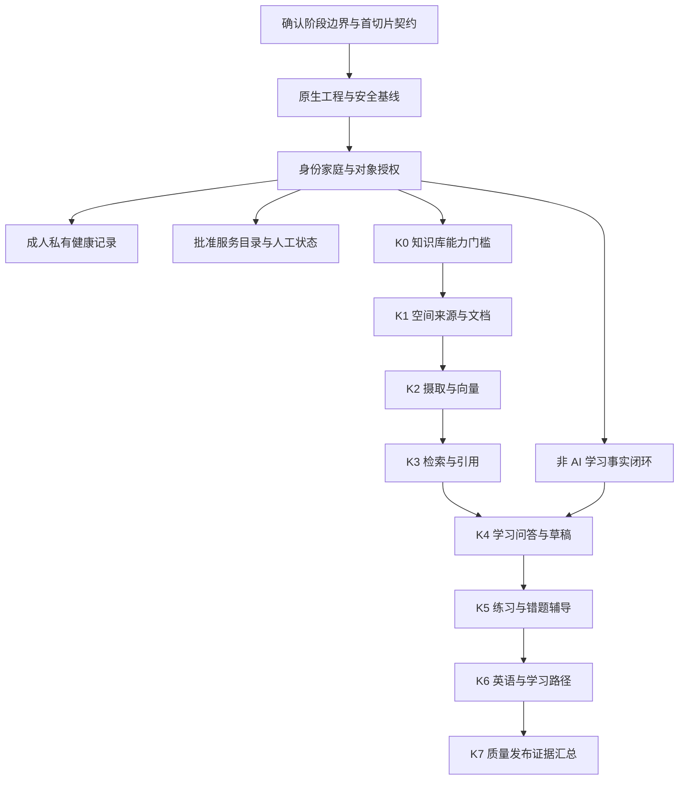

# 分阶段实现与验证方案

## 1. 目标与适用范围

本方案把现有需求组织为可逐步验证的实现顺序，不新增业务能力、不替代各模块需求，也不表示工程已实现。
保留 Java 21、Spring Boot MVC/Security、MyBatis-Plus、Flyway、Spring AI、PostgreSQL/pgvector 和 Art Design Pro 开源版；不拆微服务、不另建前端壳或通用 Agent 平台。
方案来源为[优化机会分析](../analysis/2026-10-27-project-optimization-understanding.md)的 OPT-01 至 OPT-08；原始范围和优先级仍以[需求总览](../requirements/00-overview.md)及各模块需求为准。

本轮只优化文档方案，不生成工程、OpenAPI、迁移或测试实现，不启动运行账本，不执行提交、推送、PR、部署或生产操作。
“基础学习闭环”“知识库首闭环”和“全项目 P0 完成”是三个不同的里程碑，不能互相代称。
所有待确认项仅阻断依赖它的功能；不得用占位页面、演示数据或尚未验证的外部能力冒充交付。

## 2. 尚未确认的业务决策

以下是待用户确认的候选方案，不是已采纳规则。未获明确选择时不改写对应原文，也不据此扩大访问权或降低优先级。

| 决策 | 原始证据 | 推荐候选（未批准） | 依赖及安全边界 |
| --- | --- | --- | --- |
| D01：敏感数据授权主体 | [身份](../requirements/01-identity-family-access.md)`FR-IAM-023/033/034`与[管理](../requirements/07-administration-audit-preferences.md)`FR-ADMIN-004` | 成人本人同意后授权；家长管理入口不产生代同意权 | 跨成人共享及有关 AI 汇总启用前确认；可先做本人私有数据，未决时不开放代授权功能。 |
| D02：偏好和内容标签优先级 | [工作台](../requirements/02-workspace-global-experience.md)`FR-WS-005/006/044`、[管理](../requirements/07-administration-audit-preferences.md)`FR-ADMIN-010/012`及 KB/LAI 壳的 P0 | 不降级已有 P0，按场景映射基础偏好保存恢复与实际主题/专注/标签能力 | S02 必须列出逐项完成/待决状态；保存未实现功能的配置不算该功能完成，相关 P0 未完成不得宣称全项目 P0 完成。 |
| D03：当前主体与目标成员 | [AI 架构](02-learning-ai-architecture.md)§5.1与[API 契约](04-knowledge-ai-api-contract.md)§2、§8.1 | 当前身份服务端解析，`targetMemberId`只标识待授权的业务目标 | AI 跨成员 DTO 定稿前确认；普通对象访问始终服务端校验，不得将客户端 ID 当权限事实。 |

其他原有待定按功能启用顺序确认，不凭空补业务事实：成人注册/首位家长初始化、儿童登录与监护、上传和保留策略、模型及 Embedding 配置、目标规模和部署环境。
儿童独立登录属于原文 P1：S04 不因此自动新增 P0 登录需求；未启用独立登录时，只能声明家长管理流程及受控测试身份的儿童权限验证完成，不能声称儿童已能独立使用。

## 3. 阶段、范围与依赖

图中并列表示业务依赖独立，不要求并行开发或多代理协同。S05/S06 可与知识库分开验收，不受模型可用性阻断，但它们尚未完成的 P0 仍保留在全项目范围内。
沿用[知识库交付切片](../requirements/11-knowledge-ai-delivery-slices.md)的 K0–K7，不重编号。K7 是发布证据汇总，不是首次开始授权、安全、评测、备份或测试工作的时间点。

| 全局阶段 | 包含步骤 | 可声明完成的范围 | 不能据此声明完成的范围 |
| --- | --- | --- | --- |
| B0：工程与访问基线 | S01–S03 | 已确认契约、原生构建、身份家庭、对象授权、家庭设置与受限审计查询 | 真实学习闭环、成人共享、知识库、AI或全项目 P0 |
| B1：基础学习 | S04 | 手工内容/单选/尝试/学习时长/真实工作台、站内通知及适用审核审计 | 独立儿童登录未启用时的独立使用；知识问答或 AI 能力 |
| B2：其他基础领域 | S05、S06 | 成人手工健康、批准服务链接与人工状态各自的已实现范围 | 自动设备采集、自动探测、完整营养建议、全家健康读取权 |
| B3：知识库证据链 | K0、S07–S09 | 来源/版本/受控摄取/授权检索/可访问引用 | 已启用模型问答、复杂解析、全部 P1 检索能力 |
| B4：受审核学习 AI | S10–S11 | 通过真实模型验证的问答、草稿、正式采纳和练习辅导范围 | 英语/路径、语音、模型自动发布或执行工具 |
| B5：扩展与发布 | S12–S13 | 实际覆盖的扩展需求与发布版本证据 | 未完成需求；任何生产发布或删除授权 |

## 4. 有序步骤与退出条件

步骤按依赖实施；每步先确定最小契约/反例，再实现服务端与真实界面，执行聚焦测试后才扩大范围。以下是未来实现任务，不是本轮执行记录。

### S01：确认阶段边界与最小契约

- 输入：第 2 节决策、[需求总览](../requirements/00-overview.md)、[API 契约](04-knowledge-ai-api-contract.md)。
- 产物：按原始 ID 列出本阶段 P0/P1、待决/延期原因；首切片 OpenAPI，包含 operationId、DTO、ProblemDetail、分页、授权、幂等及版本冲突；不提前列齐远期 API。
- 退出：契约可解析，合法/非法样例及前后端类型一致；任务与草稿状态分别建模。D01–D03 保持显式状态，不依靠默认解释消除冲突。
- 失败：有冲突只暂停相关 DTO/操作，保留其余可确定步骤；阶段缩小不能被写成原 P0 降级。

### S02：复用原生工程并建立安全基线

- 输入：[总体架构](README.md)的模板来源、Java 21、Boot/AI 兼容策略及[前端架构](03-frontend-architecture.md)。
- 产物：固定 Art Design Pro 开源 tag/commit、许可证和锁文件；原生目录/布局/API 客户端/组件；Initializr Maven Wrapper 工程、统一安全错误、Flyway、脱敏请求关联和 AI 默认关闭。
- K0 衔接：普通业务迁移与可选知识库扩展检查/迁移分开启用；无模型或 pgvector 时普通业务仍可启动，知识库能力明确不可用，不将数据库连接失败伪装成正常。
- 退出：原生构建、基础真实 API/错误对接、空库与升级迁移、未认证拒绝、无秘密检查通过；无生产演示账户、Mock 指标、硬编码令牌。偏好与壳能力按 D02 逐项记录。
- 失败：框架兼容或模板许可未核实不推进复制；迁移失败安全停止对应能力，不篡改已执行迁移或静默跳过错误。

### S03：身份、家庭与对象授权

- 输入：[身份需求](../requirements/01-identity-family-access.md)`FR-IAM-*`、[家庭管理](../requirements/07-administration-audit-preferences.md)`FR-ADMIN-001`至`005`、`020`至`023`及注册/初始化决策；不假设公开注册或已有身份提供商，`004`仍受 D01 约束。
- 产物：服务端活动家庭/合法成员上下文、认证会话/停用/角色能力、逐对象查询授权；家长成员列表及可管理操作确认、家庭名称/时区/已允许基础开关维护、脱敏审计写入与受限只读查询的 API/UI。
- 管理验收：列表仅显示允许的成员字段；成员创建/停用/角色调整显式确认，儿童登录变更只在原 P1 功能启用后验证；设置影响后续请求且有审计，时区变更提示影响但不改写历史 UTC。
- 审计验收：覆盖已实现业务的认证/会话/成员/授权/计划事件，后续服务/AI/导出各在其启用步骤接入；查询同时按家庭和事件对象权限裁剪，普通业务接口不能修改/删除事件，不把高级筛选/导出 P1 提前实现。
- 退出：合成样本的正常/伪造 ID/停用/撤权后下一请求均验证；普通成人/儿童/跨家庭管理调用拒绝，有权家长也不能查询无对象权限的审计；管理员不天然获得家庭数据，成人私有学习健康不因家长身份开放，前端路由不是授权依据。
- 失败：拒绝响应与不存在策略一致、可访问计数不泄漏；D01 未决时不启用代成人授权，不对日志输出完整敏感输入。

### S04：手工学习与事实工作台闭环

- 输入：S03、[学习需求](../requirements/03-learning-knowledge.md)`FR-LEARN-001`至`005`、`010`至`013`、`020`至`024`、`030`至`033`及[工作台](../requirements/02-workspace-global-experience.md)的 P0，通知明确覆盖`FR-WS-030`至`032`。
- 产物：计划派生任务、手工内容/默认私有笔记/已发布单选、题目及答案的历史解释策略、服务端答题尝试与计分、真实进度/今日任务/按角色工作台。
- 时长路径：最小采用手填学习时长及有权计划/内容/任务关联，提供录入 API、持久事实、明细及界面；若接收起止时间则校验顺序。拒绝负时长/逆序时间/无权关联，同次重试不重复累计，不引入自动计时、反作弊或 P1 会话更正。
- 通知路径：任务到期/练习反馈事件生成按接收者裁剪的站内通知，提供列表、未读计数、幂等已读和目标跳转 API/UI；同事件同收件者不重复生成，刷新保持一致，读取/计数/跳转均重授权。AI 草稿/服务异常分别由 S10/S06 接入，通知类型配置及全局搜索仍为 P1。
- 退出：提交前不下发答案；同次重试一条记录、新尝试另记；题目修改/归档后旧尝试可解释；修改未完成任务不篡改完成事实。成人时长录入后明细/进度/工作台一致，家长无授权不可见；儿童/家长进度按管理范围验证，周期/时区/更新时间/口径明确。
- 退出反例：UTC 与家庭时区跨日统计一致；时长独立于答题尝试，不把点击提交换算为学习时长；通知撤权后标题/摘要/计数/目标均不泄漏，儿童不见成人健康或服务配置。
- 失败：并发/重复写入不双计分或重复完成；无事实用真实空态，不以页面停留伪造学习时长；独立儿童使用按第 2 节原优先级约束验收。

### S05：成人私有健康记录

- 输入：S03、[健康需求](../requirements/04-health-fitness-nutrition.md)的 P0 记录/营养来源/共享边界。
- 产物：本人运动与餐食记录、单位/时间/非负校验、营养来源/估算/未知、人工修正及明细聚合；不收集基础记录无须提供的疾病等资料。
- 退出：修正保留原来源/值/说明，未知不是精确零；删除/更正反映到有权摘要；本人私有范围的 API/聚合/UI 均通过测试。
- 失败：D01 未决则共享功能保持未完成，相关 P0 不得划为完成；任何未来授权/撤销都须跨列表、统计、AI 输入和导出验证。不作医疗结论或设备直连。

### S06：批准服务目录与人工状态

- 输入：S03、[家庭服务需求](../requirements/05-family-services.md)及部署允许列表。
- 产物：受控服务地址/图标/可见范围、浏览器直达链接、人工状态及来源/时间、配置审计；已批准服务人工记录异常时接入 S04 通知，摘要不暴露内网细节，儿童默认不可见。
- 退出：保存前验证网络策略与地址，禁止凭据/任意 URL/代理/命令；停用即时隐藏、过期状态不当正常，服务器不因点击链接向目标发送代理请求；配置变更可被有权用户审计查询，异常通知有权且幂等，无须提前实现自动探测。
- 失败：白名单未确认则不接受新地址；无检查为未知。自动探测仍为原文 P1，启用前另验 DNS、重定向、超时/大小和独立网络策略，不借本步骤扩范围。

### S07：K1 空间、来源与不可变版本

- 输入：K0 门槛、[知识库需求](../requirements/09-knowledge-base-rag.md)`FR-KB-001`至`026`；来源许可、上传类型/大小、存储、内容扫描及保留策略在相关操作启用前确认。
- 产物：空间/来源/文档/版本及授权、受控上传/下载、最小元数据、清晰许可/归档状态与审计；相同文件处理遵守原文版本策略。
- 退出：跨家庭/成员无法读取或推断存在；待核验来源不进入正式摄取；归档/撤权立即排除新检索，历史引用保留可解释性但不能借历史继续访问无权原文。
- 失败：文件校验/扫描/许可失败不可被标为可检索；物理删除和保留清理按对象策略，不把“不可检索”等同“已经清除备份”。

### S08：K2 摄取、Embedding 与持久任务

- 输入：S07、实际 Embedding 模型 ID/维度/费用/驻留/额度；这些在首次外发或写向量前确认，不能等 K2 完成才核验。
- 产物：可观测的持久任务、版本化解析/分块及定位、派生向量、有限重试/取消/恢复；复用 Spring AI，数据库任务先行，不强制 Redis 或消息平台。
- 退出：幂等键包含家庭/文档版本/策略及模型空间；同版本重试不重复，崩溃重启可恢复，维度/模型不符不污染既有向量空间。
- 失败：模型/文件 IO 不占长数据库事务；外发前与结果提交前重验来源/权限/版本，撤权或取消后的结果不写成可检索；失败可见且不无限重试。

### S09：K3 SQL 内授权检索、引用与评测

- 输入：S08、部署数据规模与最小许可评测集、[知识库架构](01-knowledge-base-pgvector.md)授权查询和索引策略。
- 产物：P0 语义召回/规则重排/去重/预算、SQL 内家庭/成员/许可/版本/归档谓词、版本/分块/定位引用、引用预览重授权。
- 退出：禁止全局 Top-K 后应用层过滤；无资料不造引用；撤权后下一查询/预览无泄漏；固定样本覆盖中文章节、英文精确词、表格、无资料、冲突、注入和禁止命中。
- 范围：K3 表中的词法混合、独立重排、检索检查器按各自原始 P1/P0 ID 分别验收，不将 K3 误当全部 P0，也不无声删除 P1。
- 测量：记录环境、维度、资料量/过滤选择性、允许/禁止命中、引用有效性、延迟/token/费用；无执行计划与前后对比不宣称索引、缓存、分区或量化有收益。

### S10：K4 最小学习问答与草稿审核

- 输入：S04、S09、D03 及真实 modelId/协议/结构化输出能力、儿童内容规则、token/费用/驻留和审核策略。
- 产物：先在测试替身验证状态与草稿/人工审核链，再接经核实的真实模型；测试替身不能算真实模型能力验证。待审核草稿接入 S04 的有权站内通知，审核/拒绝接入 S03 审计查询。将资料/用户问题视为不可信输入，不给模型命令或任意网络工具。
- 退出：只用当次有权最小证据，预算含输出/安全余量，1M 是上限而非默认；生成结果通过 schema/领域/内容/来源校验，人工确认前不写正式业务。
- 失败：关闭/超时/限流/取消/无资料/冲突/撤权/过期均有独立可恢复状态；后续回合、旧草稿查看与采纳重授权；不输出原始内部推理或跨成员上下文。

### S11：K5 错题辅导与练习采纳

- 输入：S10、[学习 AI](../requirements/10-learning-ai-experience.md)`FR-LAI-020`至`036`和既有学习领域校验。
- 产物：基于有权题目版本/真实尝试的提示、结构化练习草稿、家长编辑审核/拒绝/显式采纳；正式题目保留草稿/来源/策略版本关联。
- 退出：先提示而非默认代答；并发采纳只生成一次领域事实；审核权限、目标范围、来源有效性与当前版本再次验证。复习任务关联按原 P1 单独标记，不混入 P0 完成声明。
- 失败：schema/答案/来源/内容不合格不能发布；采纳失效返回可恢复冲突，不静默覆盖人工编辑或重复创建任务，不以单次错误固定画像。

### S12：K6 英语与路径扩展

- 输入：S11 与相应原始 P1/P2 的启用决策，不因路线图出现而提升为首期承诺。
- 产物：英语文章/词汇/理解练习、选择性采纳的路径/反思草稿；事实引用与原创文本分开。
- 退出：只用已确认学习信号；不推断心理/医疗状态、不自动批量建任务；语音、复杂解析、外部连接器、自动探测各按独立授权与范围评审。

### S13：K7 汇总发布证据

- 输入：拟发布范围的真实测试/迁移/模型/安全/评测记录及未完成清单，含 S05/S06 等非知识库 P0；不要求为小版本先完成所有 P1/P2 才可验证。
- 产物：版本/迁移清单、需求 ID 到证据映射、已知风险、部署配置、备份恢复演练与停用/恢复策略。
- 退出：各切片持续完成的负向测试与 CI 必需门禁汇总可复核；原性能目标按参考部署实测；质量回归阻断策略升级，恢复演练使用获准的非生产环境。
- 失败：测试/迁移/安全不通过不标通过；不能以本方案批准生产发布、数据库破坏性回滚、删除数据或绕过外部人工审批。

## 5. 共用设计边界

### 5.1 领域、数据及组件复用

| 对象 | 决策与理由 |
| --- | --- |
| 后端领域与接口 | 复用已定 Controller/Service/Repository 分层；IAM、学习、健康、服务、知识库、学习 AI 按领域组织。共享授权上下文、统一错误和审计一次建设，不让控制器直写 SQL。 |
| 表和状态 | 当前无已实现表。后续只按切片新增所需规范表、关系/授权、快照/任务/审计及派生向量，复用[知识库数据模型](01-knowledge-base-pgvector.md)的定义；不预建所有领域表或引入全量事件溯源。 |
| 事实与聚合 | 题目版本/尝试/健康修正为事实，待办/工作台/AI 输入从有权事实计算；先用可核验查询，不用冗余缓存制造第二事实源。 |
| 前端 | 复用上游布局/路由/请求封装/表单/主题/权限提示及图标组件；新增的仅是领域视图和必要状态适配，不重建 API 客户端或独立设计系统。 |
| AI | 复用 Spring AI 的 ChatClient/ChatModel/EmbeddingModel；业务只负责授权、预算、任务/草稿、校验和审计，不重复封装供应商 SDK。 |

### 5.2 跨请求、异步与撤权

同一套合成样本贯穿对象详情、列表/计数、工作台、站内通知、审计查询、搜索（原 P1 功能启用后）、附件/引用预览、后续对话、异步任务提交和采纳。
每处都验证角色、家庭、成员私有范围、当前授权/许可/版本；已有缓存时其修订/失效必须覆盖权限变化，未引入缓存时不为测试专建缓存。
SQL 查询就包含权限谓词；生成前重验，外发后的内容无法宣称被远端收回，因此还须明确驻留/保留策略并在本地阻断后续写入、查看和采纳。
关键写入以短领域事务、唯一约束和参数摘要保证幂等；同键变参、旧版本、重复提交分别定义，不能只靠前端按钮禁用。
取消通过持久状态/条件更新阻止后续写入，外部请求不能取消时如实显示，不承诺已经发生的外发成本或副作用可逆。
日志只保留请求关联、任务/模型/策略版本、脱敏结果和用量，不保存完整儿童/健康/家庭上下文；审计结果不得因业务回滚伪造成功。

### 5.3 外部能力最小清单

| 能力 | 最晚确认点 | 缺失时行为 |
| --- | --- | --- |
| 开源模板与 Boot/AI 兼容版本 | S02 首次安装前 | 不猜版本或复制商业资产；仅阻断相关搭建。 |
| 成人注册/首家长初始化与会话方案 | S03 对应入口前 | 不新增默认公开注册或生产演示账户。 |
| 存储/许可/类型大小/扫描/保留/备份 | S07 相应上传和内容处理前 | 不接受无法安全处理的上传；不采用无限保留默认值。 |
| PostgreSQL/pgvector 版本和扩展权限 | K0 / S08 向量迁移前 | KB 安全不可用，普通业务正常；与原 K0→K1 门槛一致。 |
| Embedding ID/维度/费用/驻留/额度 | S08 首次外发前 | 可保留有权的元数据/受控原文，但不伪造向量或可检索状态。 |
| 生成模型实际 ID/协议/能力/儿童规则 | S10 首次真实调用前 | AI 保持关闭，手工业务仍可用。 |
| 规模/并发/硬件与质量阈值 | S09 基准及 S13 性能验收前 | 不宣称性能或质量达标；未定义阈值不阻塞本轮文档方案。 |
| 服务允许列表/探测网络与策略 | S06 地址保存 / 未来 P1 探测前 | 不接受策略外地址，不做任意网络探测。 |

## 6. 验收映射（acMapping）

以下引用[分析报告](../analysis/2026-10-27-project-optimization-understanding.md)的建议验收，不替代原始业务 AC；各步骤同时追溯其列出的 FR/NFR 及原始 AC。

| 建议验收 ID | 优化项 | 满足步骤 | 关键证据 |
| --- | --- | --- | --- |
| AC-OPT-001 | OPT-01 | S01、S02、S03、S10 | D01–D03 双侧证据、用户确认或待决状态；未确认原文未被擅改。 |
| AC-OPT-002 | OPT-02 | S01、S03、S04、S05、S06、S07、S13 | 原始优先级/阶段表、家庭设置与受限审计、AI 关闭的时长/学习/通知闭环、其他领域独立验收及剩余范围。 |
| AC-OPT-003 | OPT-03 | S03、S05、S07、S08、S09、S10、S11 | 同样本跨表面撤权、外发/落库/采纳前权限与来源再验证。 |
| AC-OPT-004 | OPT-04 | S01、S02、S08、S10、S11 | 可解析契约/类型、合法非法样例、分离状态、幂等/版本/取消冲突。 |
| AC-OPT-005 | OPT-05 | S02、S03、S06、S07、S08、S10、S13 | 版本/协议/存储/保留及配置来源、能力启停与失败隔离记录。 |
| AC-OPT-006 | OPT-06 | S09、S10、S13 | 固定许可样本、允许禁止命中、环境/参数/质量/成本、策略前后对比。 |
| AC-OPT-007 | OPT-07 | S03、S04、S05、S08、S11 | 重试与新尝试、题目快照、时长事实与工作台、未知营养/修正、时区及并发写入测试。 |
| AC-OPT-008 | OPT-08 | S02、S03、S04、S05、S06、S07、S10、S13 | 原生基座许可/锁文件，三角色桌面/窄屏的学习时长、通知、管理/审计等真实状态，无生产 Mock。 |

## 7. 测试策略与证据标准

当前产品目录为空，下列为后续门槛，不声称存在测试或已经执行。每切片都先做最便宜的失败反例，再做窄测试，最后运行该工程 CI 等价检查。

| 检查层 | 最小场景与执行方式 |
| --- | --- |
| 本轮文档 | 相对链接/锚点、S01–S13 和 K0–K7 连贯、8 条 AC 映射、待决状态、原文未授权变动；独立方案评审最多两轮。 |
| 后端单元/集成 | 工程建立后在后端目录用 `./mvnw.cmd test` 验证领域规则，再按 POM 配置运行 `./mvnw.cmd verify` 及实际配置的集成测试；不能把未绑定生命周期的测试当已执行。 |
| PostgreSQL/Flyway | 在隔离测试库执行空库/升级、唯一约束/版本冲突、权限 SQL、缺扩展、并发/取消、重启恢复；真实向量与外部模型分别有配置证据。 |
| 前端 | 模板建立后按锁文件用 `pnpm install --frozen-lockfile`；读取实际 package scripts 并记录原生类型/构建/测试命令，不能预设不存在的脚本。 |
| 界面与角色 | 家长/成人/儿童/跨家庭/撤权合成身份；桌面、768px 及更窄移动屏；键盘、加载/空/失败/无权/关闭/过期状态与必要动作。未启用 P1 功能标不适用，不为测试提前实现。 |
| AI/检索 | 测试替身验证状态与失败，许可固定样本验证真实召回/引用；真实模型单独验证协议/schema/费用/超时/儿童规则。替身通过不能替代真实能力验收。 |
| 安全与发布 | 原始 P0 自动化、授权/文件/AI/地址负向、秘密/依赖/静态门禁、脱敏日志、非生产备份恢复、明确版本和剩余范围。失败记录不得删改为成功。 |

每份证据至少含需求 ID、提交或内容快照、环境/依赖、实际命令与退出结果、关键输出、测试数据范围及未覆盖项；未执行、失败、不适用与通过分别记录。

## 8. 约束适用性与简化取舍

- `codeUnderstanding.skipped`：本轮为纯文档方案优化，产品目录为空；复用既有分析的文件证据，跳过再次构建代码索引及虚构受影响函数/测试。
- 未发现项目本地约束覆盖或额外约束配置。已加载包内 `arch/arch-cards.md`、`nfr/nfr-rules.md`、`nfr/conventions.md`、`front/frontend-card.md`，以下明确适用性，项目既定架构优先。
- P-1 / CARD-ARCH-LAYER：采用领域分层和共用能力；不引入约束包另一项目的包名、Mapper、BBA starter、SSO 或供应商 SDK。
- P-2 / CARD-ARCH-DATA-TYPES：无已有实现表可复用；沿用已有领域模型，仅随切片新增。精确数值、UTC 时间、布尔/枚举和版本事实按本项目需求确定，不强制 BaseEntity/自增 ID/另一项目的公共字段。
- P-3 / CARD-ARCH-FRONTEND / CARD-FRONT-CRUD：采用原生组件复用、图标可访问性、完整状态和主题一致性；保留 Art Design Pro 的依赖、图标、主题与目录，不套用包内另一项目的旧版本锁定、固定品牌色或额外图标库。
- NFR-TXN / NFR-IDEM：采用短事务、外部 IO 隔离、数据库唯一约束/幂等及并发校验；Kafka、Mapper XML、固定批量/连接池阈值仅有实际场景才评估，不为规则引入新依赖。
- CARD-NFR-DDL / CARD-NFR-MBP：按最新选型采用 MyBatis-Plus 业务持久化与 Flyway 不可变迁移；所有项目物理表强制采用 `bingo_` 前缀，按[数据库表命名规范](README.md#数据库表命名规范强制)校验迁移与映射。分页、乐观锁及全表更新/删除保护按实际场景验证。复杂授权与 pgvector 查询使用参数化自定义 Mapper SQL，不采用另一项目 DDL 目录、自动建表或全量 `IF NOT EXISTS` 掩盖迁移漂移。
- NFR-EXC / NFR-LOG：采用统一 ProblemDetail、错误分层、请求关联与最小脱敏日志；不强制另一项目异常继承树、日志组件或 180 天保留。保留期按本项目对象策略确认。
- 包内 NFR-PERF 编号与本项目同名前缀不同；只引入批量查询/避免 N+1/执行计划对比的原则，不用通用阈值覆盖本项目性能目标或提前建索引。
- 纯文档阶段跳过代码级质量扫描、外部扫描/部署和供应商连通性验证；未来真实实现仍遵守原始非功能门禁，本轮没有这些门禁通过的结论。

## 9. 使用与维护

本文件维护实施依赖、复用边界与退出门槛；业务规则只在对应需求权威章节维护，API 细节在[契约设计](04-knowledge-ai-api-contract.md)及未来 OpenAPI 中维护，不复制成另一套规范。
独立评审及本轮校验回执放在分析目录，不把过程记录写入长期需求基线。进入实现前重读相关来源并核对变化；涉及第 2 节冲突必须先确认，任何实施、范围缩减或外部交付均不由本方案自动授权。