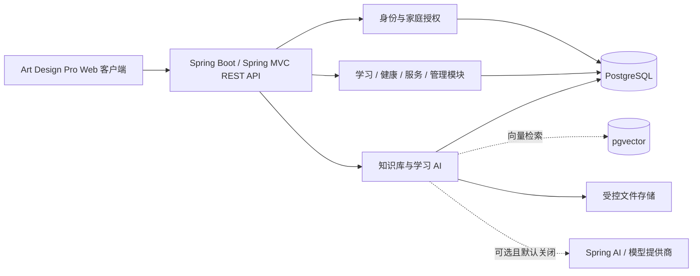

# 技术选型与总体架构

本文档集中说明平台的技术基线和模块边界。它描述目标设计，不代表所有组件均已部署；版本、扩展和性能参数须在实际环境中验证。

## 技术选型

| 层次 | 选择 | 说明 |
| --- | --- | --- |
| Web 前端 | Art Design Pro 开源版（Vue 3、TypeScript、Vite、Element Plus、Pinia、Vue Router） | 直接基于开源工程搭建，复用其布局、组件、主题与工程配置，不另起 Vue 空项目仿写外观。 |
| 后端 | Java 21、Spring Boot、Spring MVC、Spring Security、MyBatis-Plus | 模块化单体；沿用 Controller / Service / Repository 分层，业务持久化由 MyBatis-Plus Mapper 实现，不引入通用微服务后台。 |
| API | Spring MVC RESTful、JSON、OpenAPI 3、`/api/v1` | 使用资源路径、HTTP 方法与状态码；实现规范见 [API 契约](04-knowledge-ai-api-contract.md#spring-mvc-实现约定)。 |
| 主数据库 | PostgreSQL、Flyway | PostgreSQL 保存业务数据；所有结构变更通过不可变迁移管理。 |
| 知识检索 | PostgreSQL 全文检索与 pgvector | 仅用于知识库功能；授权条件在 SQL/服务端查询中执行。 |
| 文件存储 | 受控 NAS 或 S3 兼容存储 | 数据库保存元数据和受控引用，不公开上传文件。 |
| 缓存与任务 | Redis（按需）及受控后台 worker | 仅在限流、缓存或异步处理需要时引入。 |
| AI | Spring AI（ChatClient、ChatModel、EmbeddingModel），默认关闭 | 复用官方模型抽象与 starter；业务侧保留授权、预算、草稿和审计，不重复封装供应商 SDK。 |
| 部署 | Docker Compose、反向代理与 HTTPS | 主平台与外部家庭服务分开部署，入口按网络策略保护。 |

## 系统架构

业务模块共享身份、家庭上下文、API 错误格式、数据库迁移和审计能力。跨模块数据访问由服务端统一校验；前端菜单或路由不构成授权边界。

## 开源基座与搭建方式

| 用途 | 来源 | 采用方式 |
| --- | --- | --- |
| 前端工程模板 | [Daymychen/art-design-pro](https://github.com/Daymychen/art-design-pro) | 使用 MIT 开源版，保留版权与许可证；沿用上游构建、目录和公共组件，清理演示业务后接入家庭模块。 |
| 后端工程脚手架 | [Spring Initializr](https://start.spring.io/) | 生成 Java 21 / Maven 工程并保留 Maven Wrapper；按需选择 Spring Web（MVC）、Validation、Security、Actuator、PostgreSQL 和 Flyway，再引入与 Spring Boot 主版本兼容的 MyBatis-Plus starter。 |
| 持久化框架 | [baomidou/mybatis-plus](https://github.com/baomidou/mybatis-plus) | 常规 CRUD 使用 Mapper 与类型安全的条件构造；复杂关联、权限过滤及 pgvector 查询使用参数化自定义 Mapper SQL。 |
| 标准 REST 实现参考 | [spring-guides/gs-rest-service](https://github.com/spring-guides/gs-rest-service) | 参考官方控制器、JSON DTO 和测试写法；不把示例问候接口作为正式业务模块。 |
| Spring AI 接入参考 | [spring-projects/spring-ai-examples](https://github.com/spring-projects/spring-ai-examples) | 参考所需模型、结构化输出和检索示例；逐个核实子示例版本及许可，不整仓复制 Agent、MCP 或工具执行能力。 |

前端依上游 `package.json` 的 Node.js / pnpm 要求搭建，保留锁文件并固定来源 tag 或 commit。后端按 [Spring AI 官方入门文档](https://docs.spring.io/spring-ai/reference/getting-started.html)选择兼容的稳定 Spring Boot / Spring AI 版本，使用 Spring AI BOM 管理其依赖，不独立追逐两个框架的最新版本。

MyBatis-Plus 作为业务持久化主方案；分页、乐观锁及全表更新/删除保护插件按实际接口配置并测试。家庭与对象级授权仍需在 Service 和 Mapper 查询条件中显式执行，不能仅依赖租户插件或前端过滤。表结构、约束、索引及 pgvector 扩展仍通过 Flyway 不可变迁移管理，不使用自动建表替代迁移。

## 数据库表命名规范（强制）

- 本项目创建或配置管理的所有物理表必须以 `bingo_` 开头，统一使用小写蛇形命名 `bingo_<业务名>`，例如 `bingo_household`、`bingo_member`、`bingo_knowledge_document`、`bingo_training_plan`。
- 规则覆盖业务表、关联表、任务表、审计表、历史表及分区子表；不得因模块、脚手架或插件不同而省略前缀。表名须匹配 `^bingo_[a-z][a-z0-9]*(?:_[a-z0-9]+)*$`，且不得超过 PostgreSQL 默认的 63 字节标识符上限。
- MyBatis-Plus 全局表前缀统一为 `bingo_`；显式实体映射、Mapper XML、自定义 SQL 和 Flyway DDL 必须指向相同的完整物理表名，不得缺失或重复添加前缀。禁止在请求中接受任意表名进行动态拼接。
- 可配置的框架元数据表也遵循本规则；Flyway 的 `spring.flyway.table` 必须配置为 `bingo_flyway_schema_history`。PostgreSQL 系统目录及扩展自身管理的内置对象不属于项目自建表，不擅自重命名。
- 新增或变更表必须通过 Flyway 迁移；已应用迁移不可改写，已有非规范表需另建保留数据与引用的重命名迁移。迁移与 Mapper 集成测试须检查项目表名及映射一致性；不满足前缀规范不得验收。

该规范针对后端关系数据库物理表，不要求给字段、API 资源名或浏览器 IndexedDB 对象仓库添加表名前缀。

首个工程闭环是“前端构建成功 → Spring MVC 健康/基础接口 → 真实 API 对接与统一错误处理”。前端已具备本机业务页面；后端当前仅搭建 Spring Boot 4.1.2 / MyBatis-Plus 3.5.18 基础工程，尚无业务 API、真实账号或家庭授权实现。Spring AI 仅由 BOM 管理，不加载模型 starter；没有模型密钥也不应阻止框架启动。

## Redis Key 命名规范（强制）

本项目所有 Redis 物理 Key 必须以 `bingo_` 开头，`bingo_*` 是匹配规则而非字面 Key。普通与响应式模板的 Key、Hash Key 和 Spring Cache 缓存均采用固定命名空间，业务代码不得绕过统一模板直接创建其他前缀的 Key。缓存示例为 `bingo_<cacheName>::<key>`，当前基础模板仅允许字符串值，禁止 JDK 对象反序列化。Redis 数据库固定为 3；没有全库扫描、清空或跨应用清理入口。

连接口令只从环境变量或秘密管理器注入，不进入源码或示例。共享 PostgreSQL 上 Flyway 默认关闭、无业务迁移 SQL；`smoke` 启动配置完全排除外部数据库和 Redis，测试使用隔离内存库和替身，不将其通过声明为真实服务已连接。

## 专项设计

| 文档 | 内容 |
| --- | --- |
| [前端架构与交互模式](03-frontend-architecture.md) | 前端分层、模块边界、API 访问和界面架构。 |
| [知识库与 pgvector 架构](01-knowledge-base-pgvector.md) | 数据模型、摄取流程、权限过滤检索和索引策略。 |
| [学习 AI 技术架构](02-learning-ai-architecture.md) | 任务编排、上下文预算、输出校验、审核与评测。 |
| [知识库与学习 AI API 契约](04-knowledge-ai-api-contract.md) | 资源、权限、异步任务、幂等和 API 错误约定。 |
| [分阶段实现与验证方案](05-phased-delivery-plan.md) | 非 AI 基础闭环、其他业务与 K0–K7 的依赖、能力启用门槛及验收映射；待决规则不擅自定稿。 |

功能范围与验收标准见[需求总览](../requirements/00-overview.md)及各模块需求。
