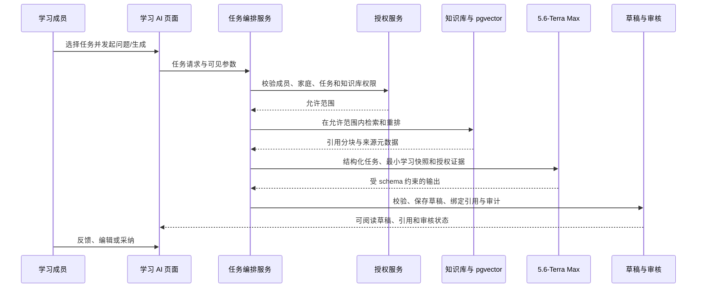

# 学习 AI 体验与技术需求

## 1. 范围

本模块定义以受控知识库为证据基础的学习 AI。它服务儿童学习和成人个人学习，提供基于来源的问答、分层讲解、苏格拉底式引导、错题辅导、练习草稿、英语文章与理解练习、学习路径建议和学习反思。所有生成内容先是可审核草稿，模型不能替代教师、家长、考试评分规则或正式业务写入。

本模块建立在 [知识库与检索增强生成](09-knowledge-base-rag.md) 的权限、来源、分块和引用能力之上，并遵守 [AI 草稿与治理](06-ai-drafts-governance.md) 中 5.6-Terra Max、最大 1M token、最小化输入、任务审计和可关闭原则。

## 2. 核心对象

| 对象           | 必需业务属性                                              | 说明                                                                   |
| -------------- | --------------------------------------------------------- | ---------------------------------------------------------------------- |
| 学习 AI 会话   | 成员、家庭、模式、关联计划/任务、状态、开始/结束时间      | 一次可恢复的辅导、问答或生成交互，不等同于开放聊天记录。               |
| 会话回合       | 会话、发起者、输入摘要、检索会话、输出草稿、状态、时间    | 一问一答或一次生成；原始敏感输入按保留策略控制。                       |
| 学习上下文快照 | 计划目标、任务、水平、允许知识库、已确认的掌握度/错题信号 | 在请求时生成、版本化并最小化，防止会话漂移或跨成员泄漏。               |
| 学习 AI 工件   | 类型、结构化内容、引用、关联会话、审核状态、采纳目标      | 包括讲解、练习、英语文章、词汇卡、复习建议和学习路径草稿。             |
| 掌握度信号     | 成员、知识点、信号类型、值/置信区间、来源、时间           | 来自答题、学习记录、人工标记或经批准 AI 解释，不是不可质疑的学生画像。 |
| 评测记录       | 任务、输入集版本、指标、结果、审核者、时间                | 用于评估检索、引用、结构与教学适配性，不以隐私资料训练模型。           |

## 3. 学习 AI 模式与访问范围

| 模式         | 目标成员             | 输入范围                               | 输出                              | 默认审核人                 |
| ------------ | -------------------- | -------------------------------------- | --------------------------------- | -------------------------- |
| 资料问答     | 儿童、成人、家长     | 用户问题、已授权知识库、必要任务上下文 | 带引用的解释或“无可引用资料”      | 本人；儿童内容由家长可审核 |
| 分层讲解     | 儿童、成人           | 知识点、目标水平、授权资料             | 概念解释、例子、检查问题          | 本人/家长                  |
| 错题辅导     | 儿童、成人           | 本人答题尝试、题目版本、授权解释/资料  | 引导提示、错因假设、复习建议      | 本人/家长                  |
| 练习生成     | 家长、成人           | 目标、难度、知识库证据、题型规则       | 待审核题目/题组草稿               | 家长或创建者               |
| 英语学习     | 成人；儿童需家长启用 | CEFR/自设水平、词汇/语法目标、授权资料 | 文章、注释、理解题、改写/对话草稿 | 创建者/家长                |
| 学习路径建议 | 家长、成人           | 目标、已授权进度与掌握度信号           | 可编辑任务/复习计划草稿           | 创建者/家长                |

## 4. 功能需求

### 4.1 会话、学习上下文与成员保护

| ID         | 优先级 | 需求                                                                                                                                  |
| ---------- | ------ | ------------------------------------------------------------------------------------------------------------------------------------- |
| FR-LAI-001 | P0     | 用户必须从明确的学习任务、内容、知识库、错题或学习 AI 页面发起会话，系统必须记录模式、目标成员、关联对象和当前家庭上下文。            |
| FR-LAI-002 | P0     | 会话开始时，后端必须生成最小化学习上下文快照，只包含完成当前任务需要的计划目标、水平、授权资料范围、本人学习信号和必要题目版本。      |
| FR-LAI-003 | P0     | 儿童会话只能读取儿童本人被分配的任务、尝试、内容和知识库；家长可按儿童管理范围查看或审核，但不能借儿童会话读取成人私有学习/健康数据。 |
| FR-LAI-004 | P0     | 成人会话默认只使用本人上下文。跨成员家庭学习总结必须遵守独立授权，显示参与范围，并允许成员在提交前取消。                              |
| FR-LAI-005 | P0     | 会话、回合、草稿和上下文快照必须有独立状态与保留期。删除、归档、撤销知识库权限或成员停用后，后续回合不得继承受影响数据。              |
| FR-LAI-006 | P1     | 用户可在会话中明确选择资料范围、学习目标、语言、输出长度和教学风格；不可选择无权知识库、他人尝试或系统提示词。                        |
| FR-LAI-007 | P1     | 系统可支持会话暂停、恢复和摘要，但恢复时必须重新验证权限与资料状态，不能盲目复用过期检索结果。                                        |

### 4.2 基于知识库的问答与讲解

| ID         | 优先级 | 需求                                                                                                                                                     |
| ---------- | ------ | -------------------------------------------------------------------------------------------------------------------------------------------------------- |
| FR-LAI-010 | P0     | 学习 AI 问答必须先执行知识库检索，再将已授权命中、来源元数据和必要相邻上下文送入生成任务；不能以模型记忆替代需要来源的学习事实。                         |
| FR-LAI-011 | P0     | 回答必须在界面中区分“基于资料的解释”“模型生成的示例”“不确定/缺少资料”三类内容，并为可验证结论显示可点击的受控引用。                                      |
| FR-LAI-012 | P0     | 当资料不充分、来源冲突或问题超出知识库时，系统必须明确局限，提出缩小问题、补充资料或查看其他来源的下一步，不能伪造引用或确定性结论。                     |
| FR-LAI-013 | P0     | 分层讲解必须接收目标成员的可见水平或用户选择的难度，并按“核心概念、例子、分步推理、检查问题、下一步”生成结构化草稿；不把内部推理链作为对用户的原始输出。 |
| FR-LAI-014 | P0     | 对儿童输出必须使用年龄适宜、任务相关且可理解的语言，避免呈现管理配置、模型元数据、成人资料或无法核验的敏感主题。                                         |
| FR-LAI-015 | P1     | 用户可对回答标记“理解了”“还需要例子”“资料不相关”“引用有问题”；反馈关联检索会话和版本，供后续质量评估，不自动改变原资料。                                 |
| FR-LAI-016 | P1     | 系统可提供追问，但每次追问仍以当前权限、剩余上下文预算和最新来源状态重新构造检索；不能把整段历史无界累加到 1M 上下文。                                   |

### 4.3 错题辅导与掌握度信号

| ID         | 优先级 | 需求                                                                                                                              |
| ---------- | ------ | --------------------------------------------------------------------------------------------------------------------------------- |
| FR-LAI-020 | P0     | 错题辅导必须读取成员自己的题目版本、答题尝试、反馈、已授权解释和关联知识点，并先确认该题目尚未归档或来源受限。                    |
| FR-LAI-021 | P0     | AI 辅导必须优先给出诊断性提问、分步提示和可选例子，而不是在用户请求辅导时直接代答；用户可明确切换到查看讲解或正确答案的授权流程。 |
| FR-LAI-022 | P0     | 错因、掌握度和学习建议必须标记为“辅助判断”并附来源信号，例如第几次尝试、关联知识点或用户反馈；不可将单次错误标为长期能力结论。    |
| FR-LAI-023 | P0     | 系统必须将答题结果、用户自评、复习完成和家长/成人人工标记作为可追溯掌握度信号；AI 不得在无证据时创建确定性掌握度记录。            |
| FR-LAI-024 | P1     | 系统可按掌握度信号生成错题复习建议、间隔复习任务或讲解草稿，采纳前必须由成员或家长确认，并保留原始建议与最终任务的关联。          |
| FR-LAI-025 | P1     | 家长可在儿童进度视图中看到脱敏的知识点掌握趋势和建议理由，但不应看到儿童与 AI 的全部自由文本对话，除非家庭策略明确允许。          |

### 4.4 练习、讲解和学习材料生成

| ID         | 优先级 | 需求                                                                                                                       |
| ---------- | ------ | -------------------------------------------------------------------------------------------------------------------------- |
| FR-LAI-030 | P0     | 家长或成人必须能根据目标、知识点、难度、题量、题型和授权资料生成讲解、例题、单选练习或复习卡草稿。                         |
| FR-LAI-031 | P0     | 生成练习必须遵守题型 schema。单选题至少包含题干、选项、唯一正确答案、解释、难度、关联知识点、来源引用和适用成员范围。      |
| FR-LAI-032 | P0     | 系统必须在草稿保存前校验练习结构、选项数量、答案唯一性、引用可见性、长度和不允许内容；校验失败时不进入可发布或可分配状态。 |
| FR-LAI-033 | P0     | AI 生成材料不得自动加入儿童任务、课程内容或成绩统计。创建者/家长必须能预览、编辑、拒绝、重新生成或显式采纳。               |
| FR-LAI-034 | P0     | 采纳后，正式内容必须保存 AI 辅助来源、草稿版本、审核者和关联引用；后续修改不应删除对原草稿的审计关系。                     |
| FR-LAI-035 | P1     | 用户可将已采纳材料与学习计划、任务、章节或错题复习关联，并配置发布日期、可见范围和完成条件。                               |
| FR-LAI-036 | P1     | 系统可检测同一生成批次中题目高度重复、题干与答案矛盾、超出目标难度或引用缺失，并将其标记为待人工处理而非自动修正发布。     |

### 4.5 英语学习 AI

| ID         | 优先级 | 需求                                                                                                                                               |
| ---------- | ------ | -------------------------------------------------------------------------------------------------------------------------------------------------- |
| FR-LAI-040 | P1     | 成人必须能指定 CEFR 或自定义水平、主题、目标词汇、语法点、篇幅、语体和资料范围，生成英语文章草稿。儿童英语模式需要家长显式启用并设置年龄适配范围。 |
| FR-LAI-041 | P1     | 英语文章草稿必须区分自创段落与基于来源的事实陈述；事实性内容附引用，目标词汇和语法点以结构化清单返回。                                             |
| FR-LAI-042 | P1     | 系统必须能从已采纳文章生成词汇注释、理解题、改写练习、情景对话或中英对照草稿，并保持与原文章/来源的关系。                                          |
| FR-LAI-043 | P1     | 用户可对目标词汇、短语、句子和练习结果做人工修正并加入个人复习计划；AI 不能在没有用户确认时推断发音、口语能力或考试成绩。                          |
| FR-LAI-044 | P2     | 听力、语音识别和口语反馈必须在单独定义音频授权、存储、转写质量、儿童保护和第三方传输范围后实现。                                                   |

### 4.6 学习路径与反思

| ID         | 优先级 | 需求                                                                                                                        |
| ---------- | ------ | --------------------------------------------------------------------------------------------------------------------------- |
| FR-LAI-050 | P1     | 家长或成人可根据明确学习目标、可用时间、已授权计划进度、掌握度信号和知识库范围生成可编辑学习路径草稿。                      |
| FR-LAI-051 | P1     | 学习路径输出必须按阶段、任务、预计时长、关联资料、检查点和风险/前提条件组织；预计时长是建议而非承诺。                       |
| FR-LAI-052 | P1     | 成员可对完成的学习会话发起反思草稿，AI 仅总结成员确认的内容、完成情况、困难与下一步；不得自动推断心理健康、人格或医疗状态。 |
| FR-LAI-053 | P1     | 采纳学习路径或反思建议时，系统必须允许选择性创建任务，防止一次采纳批量创建不可撤销的日程或学习记录。                        |

### 4.7 前端页面与 Art Design Pro 交互模式

| 页面           | 路由建议                            | 目标                   | 核心交互                                                       |
| -------------- | ----------------------------------- | ---------------------- | -------------------------------------------------------------- |
| 学习 AI 工作台 | `/learning/ai`                      | 家长、成人、获授权儿童 | 今日 AI 辅导、待审核草稿、可用知识库、最近引用与继续会话。     |
| 辅导会话       | `/learning/ai/sessions/:sessionId`  | 会话成员与审核者       | 问题、资料范围、分层回答、引用侧栏、反馈、继续学习或创建草稿。 |
| 错题辅导       | `/learning/review/:attemptId/coach` | 答题成员与管理家长     | 题目、已作答记录、逐步提示、讲解、复习任务建议。               |
| 生成工作室     | `/learning/ai/studio`               | 家长、成人             | 参数表单、资料范围、结构化预览、审核/编辑/采纳、失败重试。     |
| 英语工坊       | `/learning/english/ai`              | 成人/获授权儿童        | 水平/词汇/语法控制、文章、词汇和理解练习草稿。                 |
| AI 学习洞察    | `/learning/ai/insights`             | 家长、成人             | 掌握度信号、资料质量、建议、用户反馈与风险说明。               |

| ID         | 优先级 | 需求                                                                                                                                                               |
| ---------- | ------ | ------------------------------------------------------------------------------------------------------------------------------------------------------------------ |
| FR-LAI-060 | P0     | 学习 AI 页面必须复用 Art Design Pro 风格应用壳、顶部工具、上下文导航、面包屑、内容标签、筛选表格、状态卡和右侧抽屉；页面使用家庭学习语义，不复制商业版文案或资产。 |
| FR-LAI-061 | P0     | 会话页面必须把用户问题、资料范围、AI 回答、引用、生成状态、审核状态和下一步操作视觉分离；引用不能只存在于悬停提示中。                                              |
| FR-LAI-062 | P0     | 生成中、检索中、无资料、来源冲突、AI 关闭、超时、结构校验失败、权限撤销和草稿过期必须有独立可理解状态，且不清空用户已输入参数。                                    |
| FR-LAI-063 | P0     | 儿童 AI 页面必须减少配置密度，突出“开始辅导”“查看资料”“再试一道”和“请家长帮助”等明确操作；不呈现模型名、token、技术分数或成人审核信息。                            |
| FR-LAI-064 | P1     | 管理者可在草稿审核界面并排查看草稿、最终编辑、引用、结构校验和目标对象；采用抽屉/详情页完成审核而非在表格内堆积长文本。                                            |
| FR-LAI-065 | P1     | 会话、草稿和生成列表必须支持按成员（仅有权范围）、任务类型、知识库、状态、时间和来源状态筛选；移动端保持可完成审核和查看引用。                                     |

### 4.8 模型调用、输出契约与评测

| ID         | 优先级 | 需求                                                                                                                                                            |
| ---------- | ------ | --------------------------------------------------------------------------------------------------------------------------------------------------------------- |
| FR-LAI-070 | P0     | 每种学习 AI 任务必须定义版本化系统策略、输入 schema、输出 schema、必需引用字段、可选字段、最大输出预算和失败回退策略；业务代码不得依赖自由文本的临时解析。      |
| FR-LAI-071 | P0     | 若提供商支持结构化输出，系统必须以 JSON schema 或等价约束请求并服务端验证；若不支持，必须采用受控解析、严格校验与失败重试，不可把未经验证文本直接写入业务对象。 |
| FR-LAI-072 | P0     | 上下文组装器必须为系统策略、用户请求、学习快照、检索资料、引用元数据和预留输出分别预算 token，总量不超过配置的 1M 上限，且保留安全余量。                        |
| FR-LAI-073 | P0     | AI 任务必须支持超时、取消、限流、配额、幂等键和状态查询。重复提交同一生成请求不得创建多份独立草稿或消耗不可解释的额度。                                         |
| FR-LAI-074 | P1     | 系统必须维护脱敏、许可明确的评测集，至少度量检索相关性、引用覆盖率/有效性、结构输出通过率、重复率、年龄/难度适配和人工采纳率。                                  |
| FR-LAI-075 | P1     | 模型、提示词、分块、Embedding 或重排策略升级前，必须对固定评测集运行回归比较；质量下降、引用缺失或安全规则回归时不得自动切换生产默认版本。                      |
| FR-LAI-076 | P1     | 用户反馈、家长审核和练习结果可作为评测信号，但未经明确、独立同意不得将儿童、健康或私有学习内容用于训练第三方模型。                                              |

## 5. 学习 AI 请求处理流程

## 6. 关键业务规则

- 学习 AI 对话不是自由无限聊天。每个回合都受当前任务、角色、知识库范围、来源状态、token 预算、审核策略和保留期约束。
- 模型不得接管评分、学习计划、错题本或任务分配。它只能提出草稿、提示和解释，正式对象由已验证 API 和明确采纳动作创建。
- 对儿童，解释、难度、反馈和可见资料必须按分配范围与家长策略过滤；不能因“个性化”收集不必要个人资料。
- 对成人，个人学习记录和英语资料默认私有。家长或其他成人查看 AI 洞察仍需要适当授权。
- 资料引用证明输出有可检查的依据，不保证答案完全正确。用户可查看来源、标记问题并要求人类复核。

## 7. 验收标准

| 编号       | 验收场景                                                                                                         |
| ---------- | ---------------------------------------------------------------------------------------------------------------- |
| AC-LAI-001 | 儿童从自己的任务发起资料问答时，后端仅检索被分配的知识库和内容；回答中每条可验证结论显示有权可看的引用。         |
| AC-LAI-002 | 资料不足、来源失效或冲突时，学习 AI 显示局限和下一步，不生成伪造引用或将模型创作描述为资料事实。                 |
| AC-LAI-003 | 儿童错题辅导先给出逐步提示；只有经过明确流程后才显示讲解/答案，并保留与具体尝试和题目版本的关联。                |
| AC-LAI-004 | AI 生成单选练习在通过 schema、选项、唯一答案、引用和权限校验前不能采纳或分配给儿童。                             |
| AC-LAI-005 | 家长审核并编辑 AI 草稿后，正式学习内容保留草稿版本、审核者、引用和采纳时间；未采纳草稿不出现在儿童任务中。       |
| AC-LAI-006 | 成人生成英语文章时，目标词汇、语法点、文章、注释和理解题以结构化草稿呈现；资料事实有引用，自创段落有清晰标识。   |
| AC-LAI-007 | 撤销成员的知识库授权或归档来源后，会话后续回合不再检索或展示受影响资料，即使会话尚未过期。                       |
| AC-LAI-008 | AI 关闭、超时、额度耗尽或结构校验失败时，用户看到可恢复状态，原任务、学习记录和已保存参数不丢失。                |
| AC-LAI-009 | 学习 AI 页面在桌面和窄屏下均能查看引用、提交反馈、审核草稿和退出会话；儿童端不暴露技术评分、模型配置或成人资料。 |
| AC-LAI-010 | 评测集能检测检索策略或模型升级导致的引用覆盖、结构通过率、难度适配或安全规则回归，并阻止未经审核的默认切换。     |

## 8. 关联文档

- [知识库与检索增强生成](09-knowledge-base-rag.md)
- [学习与知识管理](03-learning-knowledge.md)
- [AI 草稿与治理](06-ai-drafts-governance.md)
- [工作台与全局体验](02-workspace-global-experience.md)
- [非功能与质量要求](08-non-functional-quality.md)
